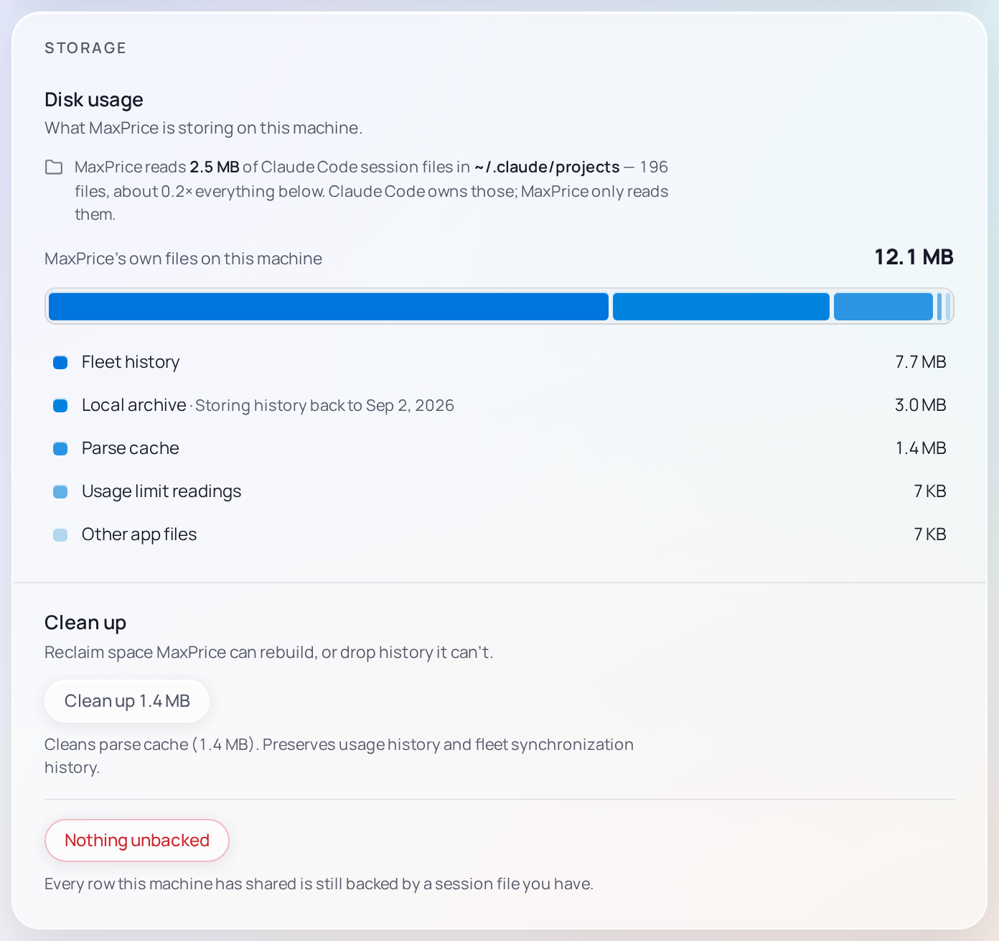

# The archive and where data lives

Claude Code deletes its old session logs, after 30 days unless you change its `cleanupPeriodDays` setting. MaxPrice keeps its own copy of your usage, so your reports reach back further than the logs do.

## The Local archive

The Local archive is MaxPrice's copy of this machine's own usage. Every request MaxPrice reads from a session log goes into it, and it is kept after Claude Code deletes that log. Where a log is already gone, the archive is the only copy.

- **It holds usage alone:** when each request ran, its model, its token counts and cost, the directory it ran in, and its session and Organization. It holds none of your prompts or Claude's replies.
- **It is always on.** It needs no Hub and has no setting.
- **It starts when you install MaxPrice.** History from logs Claude Code deleted before then can't be recovered.
- **It holds only Tracked organizations' usage.** An [Excluded organization](organizations.md#tracked-and-excluded-organizations)'s usage is never written to it.

With a [Hub](hubs.md), the Hub keeps an archive of the whole fleet's usage too, and the [Fleet replica](hubs.md#fleet-replica) is this machine's copy of it.

## Storage in Settings

Settings › Storage shows what MaxPrice keeps on this machine. Its first line sizes Claude Code's own session logs, which MaxPrice reads but never changes. The bar below it splits MaxPrice's own files:

- **Fleet history:** the Fleet replica, with a Hub;
- **Local archive**, with the date it reaches back to;
- **Parse cache:** what MaxPrice has already read from each session log, so a restart reads only what changed;
- **Usage limit readings:** the limit readings from claude.ai;
- **Logs**, capped at 5 MB with one older copy kept;
- **Other app files:** settings, machine and project identity;
- **System webview**: the window's own browser data.

**Clean up** frees the space MaxPrice can rebuild: the parse cache and unused space in its databases. It keeps your usage history and what this machine shares with a Hub.

With a Hub and the Fleet replica, a second button, **Forget N rows…**, deletes the usage this machine shared whose session logs are gone, from the Hub and from this machine's archive. It asks you to type the machine's name first, because it can't be undone. While every shared row still has its log, it reads **Nothing unbacked**.

## Where data lives

### Desktop client

The Desktop client keeps its settings, its archive, its caches and its logs in one folder. Only the window's own browser data, the **System webview** in Storage, sits elsewhere on macOS and Windows.

| System  | Folder                                                                    |
| ------- | ------------------------------------------------------------------------- |
| macOS   | `~/Library/Application Support/com.maxprice.desktop`                      |
| Windows | `%APPDATA%\com.maxprice.desktop`                                          |
| Linux   | `~/.local/share/com.maxprice.desktop`, or under `$XDG_DATA_HOME` when set |

In it, `settings.json` holds the settings, `local-archive.sqlite` the Local archive, `fleet-events.sqlite` the Fleet replica, and `logs/sidecar.log` the log. The claude.ai [session key](blocks.md#the-claudeai-session-key) and the Hub password are never in that folder: they are in the system's keychain, the macOS Keychain, the Windows Credential Manager or the Secret Service on Linux.

### Hub tray app

The Hub's files are in `%APPDATA%\maxprice-hub`, laid out as a [Headless Hub's data dir](../../../hub/README.md#the-data-dir) is, and its log is `%APPDATA%\com.maxprice.hub\logs\hub.log`. Its session key is in the Windows Credential Manager.

### Headless client and Headless Hub

Each one's manual lists its data dir and every file in it: the [Headless client's](../../../cli/README.md#the-data-dir) and the [Headless Hub's](../../../hub/README.md#the-data-dir). Both keep their secrets in a `secrets.json` file only their user can read.

## Starting the archive over

To rebuild the Local archive, quit MaxPrice, delete `local-archive.sqlite` and its `-wal` and `-shm` files from the folder above, and start it again. MaxPrice refills it from the session logs still on disk. Usage whose logs Claude Code has already deleted can't come back into it.
