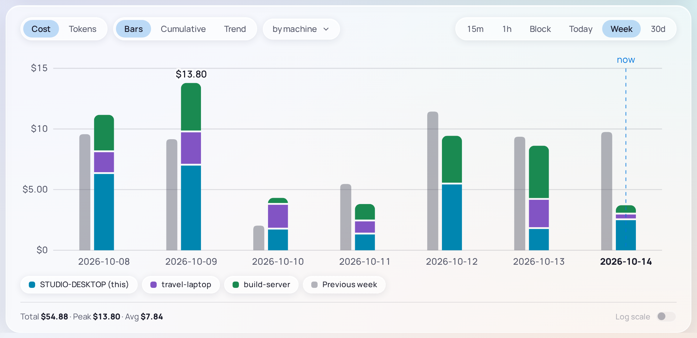

# Hubs and the fleet

A Hub is an optional MaxPrice service that runs all the time on one of your machines. Each client you join to it shares its usage through it, so every machine's reports can show the whole fleet, and the Hub reads your claude.ai [usage limits](blocks.md#usage-limits) for all of them.

There are two Hubs, which do the same job: the [Hub tray app](../hub-tray-app/overview.md) on Windows, and the [Headless Hub](../headless-hub/overview.md) on a Linux server. Run one Hub for all your machines.

## The fleet

The fleet is every machine joined to one Hub. A machine is one client: a Desktop client or a Headless client. The Hub names each machine after its hostname the first time it sees it, and keeps that name. A machine is renamed at the Hub alone: in the Hub tray app's console, or with `maxprice-hub rename` ([reference](../../../hub/README.md#maxprice-hub-rename)).

> [!NOTE]
> A Desktop client and a Headless client on the same machine are two machines to a Hub. Join only one of them ([why](../../../cli/README.md#a-desktop-client-on-the-same-machine)).

## What a Hub does

- **It reads the usage limits once for everyone.** While a client is connected, the Hub is the only thing that polls claude.ai, for every [Organization](organizations.md) its [session key](blocks.md#the-claudeai-session-key) lists. It sends each reading to every client.
- **It keeps the fleet's usage.** Each client sends the Hub its usage, and the Hub keeps every machine's in one archive. Clients copy that archive back, so each one can report on every machine.
- **It shares what you set up once:** Organization labels, project merges, assigned sessions and machine names.

## What a client sends

A client sends the Hub one Fleet event per request. Each holds when the request ran, its model, its token counts and cost, the full path of the directory it ran in, its project and session ids, and its Organization. None holds your prompts, Claude's replies or any file.

While **Share usage events** is on, the client also sends each of its checkouts' Git `origin` remote and its place in the repository, so that [checkouts fold across machines](projects.md#repo-identity), and the project merges you make on it.

Whatever the switches, it sends its machine id and hostname, its [Home organization](organizations.md#home-organization), the Organization labels and session assignments you make on it, and the limit readings it took itself. Under Auto-heal it also sends its claude.ai session key.

## The client's switches

A Desktop client joins a Hub in Settings › **Usage hub**, which has three switches, each on by default. The Headless client has the same three: two settings and an option of `maxprice hub join` ([reference](../../../cli/README.md#maxprice-hub-joinleave)).

### Share usage events

**Share usage events** sends this machine's usage to the Hub. Turning it off stops sending; what was already sent stays on the Hub. This machine's own usage stays in its [Local archive](archive.md#the-local-archive) either way.

### Fleet replica

The **Fleet replica** is a copy of every machine's usage, kept on this machine. The Machine filter, grouping **by machine** and the machine columns need it. Turning it off deletes the copy.

### Auto-heal

**Auto-heal** sends this machine's claude.ai session key to the Hub when the Hub's own key stops working. A Hub with no key at all gets one from the first client that joins with Auto-heal on.

## Fallback polling

When a client can't use its Hub, it reads the usage limits from claude.ai itself, with its own session key, once a minute, and sends those readings up when it reconnects. Settings › Usage hub says why, each ending **polling locally**:

| Status                                                       | What it means                                                       |
| ------------------------------------------------------------ | ------------------------------------------------------------------- |
| **Hub unreachable — polling locally**                        | The Hub isn't running, or this machine can't reach its address      |
| **Hub has no working Claude key — polling locally**          | The Hub's session key is missing or expired                         |
| **Hub password rejected — polling locally**                  | The Hub has a password, and this client's is wrong or missing       |
| **Hub version mismatch — update both apps; polling locally** | The Hub and the client speak different versions of the Hub protocol |

While it works the status reads **Connected — hub is polling**.

## The network

### Tailnet

A Hub is meant to be reached over a tailnet: a private network between your own devices, made by [Tailscale](https://tailscale.com). By default a Hub listens on port 47100, on its machine's Tailscale addresses and on the machine itself, and nowhere else, so only your devices can reach it. A client names it by its Tailscale name or address, as `http://my-desktop.tailnet.ts.net:47100`.

A Hub can listen on another address instead ([reference](../../../hub/README.md#bind-and-port)), but its traffic is not encrypted there. Settings › Usage hub shows a warning under an address that isn't a tailnet or loopback one, since Auto-heal may send your session key to it.

### Hub password

A Hub can also require a Hub password, which each client enters once when it joins. It adds to the tailnet's protection rather than replacing it. With no password set, any client that reaches the Hub can join.

## Versions

A client and its Hub must speak the same version of the Hub protocol. Two releases apart they may not; update the Hub and every client to the same release and they always match. Until then the client falls back to its own polling, and reads **Hub version mismatch — update both apps; polling locally**.

## The Machine filter and grouping by machine

With a Hub and the Fleet replica, the Desktop client gains a **Machine** filter, a **by machine** grouping for the Live chart, and machine columns in its tables. Your own machine is marked **(this)**.

