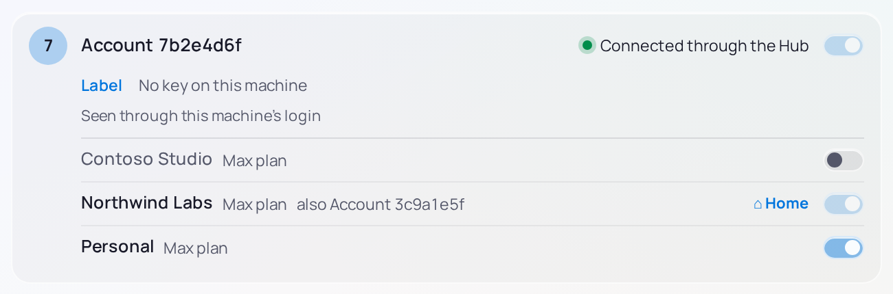

# Accounts and Organizations

An Organization is the claude.ai billing entity a request ran under: a personal Max plan, say, or a company's Team or Enterprise plan. An [Account](#accounts) is one claude.ai login. One Account can belong to several Organizations, and one Organization, such as a Team plan, can have several Accounts. Each Account's place in an Organization is a [Membership](#memberships), and each Membership has its own usage limits. MaxPrice counts usage per Membership, and on each machine you choose which Accounts and Organizations it counts.

## How MaxPrice knows the Organization

MaxPrice learns which Organization, and which [Account](#accounts), a request ran under in one of two ways, and neither comes first: from the session's own log when you log in to Claude Code directly, or from a Gateway's records when Claude Code runs through one.

**Logging in directly.** When you are signed in to Claude Code with a claude.ai login, Claude Code records the Organization a session runs under in that session's log:

- at its first request, from Claude Code 2.1.281 on, and again after a `/login` inside the session;
- when the session is attached to Remote Control, Claude Code's link between a terminal session and your claude.ai account.

**Through a Gateway.** A Gateway, such as CLIProxyAPI, serves Claude Code's requests on claude.ai logins it holds itself, so the log of a session it serves names no login. Once you connect the Gateway, MaxPrice reads its record of each request, which names the Organization and the Account that served it, and matches it to the session's line. A record fills in only a line whose own log names no Organization and no Account; it never replaces what a log says. Connect one in [Settings › Gateways](../desktop-client/settings.md#gateways), with [`maxprice gateway connect`](../../../cli/README.md#maxprice-gateway-connectlistremove) on the Headless client, or at your [Hub](hubs.md), which then reads it for every machine.

MaxPrice reads these records. A session that has none is [owner-less](#owner-less-usage).

With one Organization there is nothing to choose: [Settings › Claude](../desktop-client/settings.md#claude) shows it on your Account's card, marked **⌂ Home**. The rest of this page matters once your login belongs to two or more.

## Organization labels

MaxPrice never shows the name claude.ai gives an Organization, because it can hold an email address. It shows a label instead: the plan's name, such as "Max plan", or `Organization` and the first eight characters of its id. Click an Organization's label on an Account's card in [Settings › Claude](../desktop-client/settings.md#claude) to rename it. With a [Hub](hubs.md), your rename shows on every machine.

## Home

Each machine has one Home: its [Home membership](#home-membership), one Account in one Organization. Home's Organization is always tracked, the [Scope](#the-scope) starts on the Home membership, and owner-less usage is counted under Home's Organization. At the first launch MaxPrice picks the Organization that owned the most sessions on the machine.

To change it, choose another [Home membership](#home-membership) in [Settings › Home membership](../desktop-client/settings.md#home-membership), a section that shows once there are two or more Accounts. The new Home's Account and Organization are tracked, and the old ones stay tracked. Changing Home changes no stored usage, but this machine's owner-less usage then counts under the new Home. If the new Home's Organization was excluded, MaxPrice reads its history as tracking it does. On the Headless client, `maxprice home set` chooses another Home membership, its Account and its Organization together ([reference](../../../cli/README.md#maxprice-home-set)).

## Tracked and Excluded organizations

Every Organization is either tracked or excluded on a machine.

- **Tracked organization:** its usage counts in every report, is kept in the [Local archive](archive.md#the-local-archive), and goes to your Hub while **Share usage events** is on.
- **Excluded organization:** its usage is dropped as MaxPrice reads the logs. No report counts it or names it, and none of it reaches a Hub.

An Organization that the machine has never opted into is excluded. A new one turns up in Settings › Claude, on the card of each Account that reaches it, with a **New** tag and its switch off. One Organization's switch is the same on every card it shows on.

**To track an Organization**, turn its switch on and confirm **Track**. MaxPrice reads that Organization's history from the Claude Code session logs still on the machine. History whose logs are already gone can't be counted.

**To exclude one**, turn its switch off and type its label to confirm. Its usage leaves every report on this machine. With a Hub, this machine's sessions for it are removed from the Hub; what other machines recorded for it stays there. The session logs are not touched, so tracking it again brings back whatever they still hold.

> [!WARNING]
> Excluded usage is never written to the Local archive. Once Claude Code deletes an old log, the excluded usage in it can't be brought back.

On the Headless client, `maxprice org` lists, tracks, excludes and labels Organizations ([reference](../../../cli/README.md#maxprice-org-listtrackexcludelabel)).

## Accounts

An Account is one claude.ai login. Claude Code records in a session's log which login it runs under, and MaxPrice reads that too, or a connected Gateway's record of the login that served a request ([how](#how-maxprice-knows-the-organization)). It keeps the login's email address only as a one-way digest, on this machine alone.

Like an Organization, each Account is tracked or excluded on a machine, and usage counts only when both its Account and its Organization are tracked. A session that names no login, in its log or a Gateway's record, such as an [owner-less](#owner-less-usage) one, is counted by its Organization alone.

- **On its first launch**, and at the first start after [Reset](../desktop-client/settings.md#reset), MaxPrice counts one Account in Home's Organization: the Account of the one session key that reads that Organization, if one does, else the one that owns most of its sessions. Usage of any other Account on the machine is dropped as MaxPrice reads the logs, as an Excluded organization's is.
- **After an update** from a version that did not know Accounts, MaxPrice keeps counting every Account it found, so no report changes.
- **An Account it first sees later** is not counted: it sits under **Not tracked** in [Settings › Claude](../desktop-client/settings.md#claude) until you turn its switch on.

Excluding an Account you track asks you to type its label, and works as excluding an Organization does: its usage leaves every report on this machine, and with a Hub this machine's sessions for it leave the Hub.

On the Desktop client, connecting an Account's [session key](blocks.md#the-claudeai-session-key) in [Settings › Claude](../desktop-client/settings.md#connecting-an-account) tracks that Account, and so does its switch there. Each Account's card also lets you label it: the label replaces its email wherever MaxPrice names it. On the Headless client, [`maxprice key set`](../../../cli/README.md#maxprice-key-setlistremove) tracks the Account of the key it stores, and [`maxprice account`](../../../cli/README.md#maxprice-account-listtrackexcludelabel) lists, tracks, excludes and labels Accounts.

## Memberships

A Membership is one Account's place in one Organization. On a Team or seat-based Enterprise plan each login's seat has its own 5-hour and weekly limits, so two Accounts in one Organization are two Memberships, told apart:

- Each Membership has its own [Usage limits](blocks.md#usage-limits), and MaxPrice never adds two Memberships' limits together.
- Each Account forms its own [Blocks](blocks.md#blocks), even in one Organization.
- Cost and tokens can add up across any set of Memberships: that set is the [Scope](#the-scope).

With one Account in one Organization, as on most machines, there is one Membership, and nothing here changes.

### Home membership

The usage in Home's Organization of the Account MaxPrice counts there (most often your own login) is the **Home membership**. It is what the Scope starts on, and it holds the usage in that Organization whose Account MaxPrice can't tell too (see [Presumed organization](#presumed-organization)): other tracked Accounts' usage in Home's Organization is left out until you add their Memberships to the Scope.

## Owner-less usage

A session whose log records no Organization, and that no Gateway record names, is owner-less. These sessions are owner-less:

- sessions signed in with an API key rather than a claude.ai login;
- sessions from Claude Code before 2.1.281 that were never attached to Remote Control, scripted `claude -p` runs on those versions included;
- sessions run through a Gateway that MaxPrice doesn't read, or whose records the Gateway dropped before MaxPrice read them.

> [!TIP]
> Turn on **Remote Control at startup** in Claude Code (`/config`) so that every terminal session records its Organization, whatever its version.

### Presumed organization

MaxPrice counts owner-less usage under its Presumed organization: the Organization of the Home membership of the machine that recorded it, as that machine told your Hub, or else of this machine's Home membership. It counts under no Account, since MaxPrice can't tell which one it came from: not your [Home membership](#home-membership)'s Account, not the Account that machine told your Hub, and not one a session key connected here lists. The same goes for usage whose log records its Organization but not its Account, on this machine or another. Only usage that records its own Account keeps it. Usage with no Account still counts wherever every Account's usage does, as under the Organization's name, **All organizations** or **All accounts**, and in the default Scope too, whether one Account is tracked or several. It forms [Blocks](blocks.md#blocks) of its own, apart from every Account's. Where the Organization has only one Account MaxPrice knows of, those Blocks follow that Account's 5-hour windows, which is the only Account their usage can belong to; with two or more they are estimated from the usage alone. So the Blocks Live and Blocks show are your Home membership's Account's usage alone, and Blocks sums the rest as **account not known** ([the totals](../desktop-client/blocks.md#the-totals)), as the Headless client's [`blocks`](../../../cli/README.md#maxprice-blocks) does in a line of its own, and [`live`](../../../cli/README.md#maxprice-live) too while its Scope holds one Membership. While your Home membership's Account isn't known, these are the Blocks shown, and so they are while it has no usage at all but its Organization's usage with no Account has some, or while that usage has an Active block and your Account has none: the Active block, the tray popout and Blocks then show that usage, marked **account not known**. Once that Active block ends, your Account's Blocks are shown again. While two or more Organizations are tracked, such a session carries a **presumed** pill after its id, as in a [project's sessions](../desktop-client/projects.md#a-projects-sessions).

### Assigning owner-less sessions

[Settings › Unattributed usage](../desktop-client/settings.md#unattributed-usage) lists the last 30 days' sessions that are counted by presumption, whenever there are any. Select sessions there and choose **Assign to…** to count them under a Membership, an Organization reached through one Account; they then carry an **assigned** pill and leave the list. **Undo** takes it back, and so later does **Unassign** on the Organization's row in Settings › Claude, which clears every session assigned to that Organization.

An assignment covers the sessions you selected, not later ones. With a Hub it applies on every machine.

Assigning sessions to an Excluded organization asks first, because that usage then leaves every report on this machine. It is not deleted: it stays in the machine's archive, and tracking that Organization again in Settings › Claude, or **Unassign** on its row there, brings it back.

## The Scope

The Scope is the set of Memberships every report counts. It starts on the [Home membership](#home-membership).

- **With two or more Tracked accounts**, the Desktop client's Account filter chooses it: any Accounts, or any of their Memberships, or every one, **All accounts** ([Account filter](../desktop-client/filters.md#the-account-filter)).
- **With one Account in two or more Organizations**, the topbar's Organization chip chooses it by Organization: Home, marked **(home)**, each other Tracked organization, or **All organizations**, marked **money only** ([Organization chip](../desktop-client/filters.md#the-organization-chip)). An Organization that has no limit window, or whose limits can't be read with your key, is marked **no limits**.

Cost and tokens add up across every Membership in the Scope. [Usage limits](blocks.md#usage-limits) can't be added, so with two or more Accounts tracked a Scope of several Memberships shows a card for each on [Live](../desktop-client/live.md#the-limit-area), a [tab for each](../desktop-client/blocks.md#a-tab-per-membership) on Blocks and a [row for each](../desktop-client/tray.md#the-popout-with-several-memberships) in the Popout, and the tray icon shows the most used one's limit. With one Account tracked, [Blocks](blocks.md#blocks), the Popout and the tray describe one Organization ([whose limits a page shows](#whose-limits-a-page-shows)).

Usage whose Account isn't known counts in the default Scope, under **All accounts** and under an Organization, but never in an Account you choose by name; the Account filter lists it as a row of its own, **Account not known**.

On the Headless client, reports take `--account` and `--org`, which name the Scope by its Accounts and its Organizations ([reference](../../../cli/README.md#report-options)). With two or more Accounts tracked, a Scope of several Memberships makes `blocks` print a table for each and `live` a Limits line for each ([Headless client](../headless-client/overview.md#accounts-and-organizations)).

## Whose limits a page shows

With one Account tracked, a page shows the usage limits and Blocks of one Organization: the Scope's Organization, or Home's Organization when the Scope spans two or more Organizations, as under **All organizations**. Where the Scope spans two or more, those surfaces name the Organization they show, as in **Northwind Labs's blocks** or the Popout's **Active block · Northwind Labs**. Where two or more tracked Accounts use that Organization, its Blocks are those of the Home membership, or else of one Account in it.

With two or more Accounts tracked and a Scope of two or more Memberships, no one Organization is shown: Live, Blocks, the Popout and the chart's **Block** span name each Membership instead, and the tray icon the most used one.
