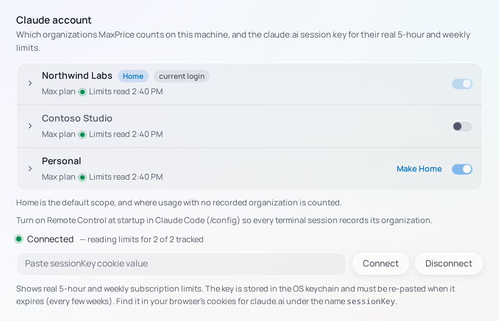

# Organizations

An Organization is the claude.ai billing entity a request ran under: a personal Max plan, say, or a company's Team or Enterprise plan. One claude.ai login can belong to several, and each has its own usage limits. MaxPrice counts usage per Organization, and on each machine you choose which Organizations it counts.

## How MaxPrice knows the Organization

When you are signed in to Claude Code with a claude.ai login, Claude Code records the Organization a session runs under in that session's log:

- at its first request, from Claude Code 2.1.281 on, and again after a `/login` inside the session;
- when the session is attached to Remote Control, Claude Code's link between a terminal session and your claude.ai account.

MaxPrice reads that record. A session that has none is [owner-less](#owner-less-usage).

With one Organization there is nothing to choose: Settings › Claude account shows it as the Home organization. The rest of this page matters once your login belongs to two or more.

## Organization labels

MaxPrice never shows the name claude.ai gives an Organization, because it can hold an email address. It shows a label instead: the plan's name, such as "Max plan", or `Organization` and the first eight characters of its id. Click a label in Settings › Claude account to rename it. With a [Hub](hubs.md), your rename shows on every machine.

## Home organization

Each machine has one Home organization. It is always tracked, the Organization scope starts on it, and owner-less usage is counted under it. At the first launch MaxPrice picks the Organization that owned the most sessions on the machine.

To change it, choose **Make Home** on another Tracked organization in Settings › Claude account. Changing Home reads nothing again and changes no stored usage, but this machine's owner-less usage then counts under the new Home. On the Headless client it is `maxprice org home` ([reference](../../../cli/README.md#maxprice-org-listtrackexcludehome)).

## Tracked and Excluded organizations

Every Organization is either tracked or excluded on a machine.

- **Tracked organization:** its usage counts in every report, is kept in the [Local archive](archive.md#the-local-archive), and goes to your Hub while **Share usage events** is on.
- **Excluded organization:** its usage is dropped as MaxPrice reads the logs. No report counts it or names it, and none of it reaches a Hub.

An Organization that the machine has never opted into is excluded. A new one turns up in Settings › Claude account with a **New** tag and its switch off.

**To track an Organization**, turn its switch on and confirm **Track**. MaxPrice reads that Organization's history from the Claude Code session logs still on the machine. History whose logs are already gone can't be counted.

**To exclude one**, turn its switch off and type its label to confirm. Its usage leaves every report on this machine. With a Hub, this machine's sessions for it are removed from the Hub; what other machines recorded for it stays there. The session logs are not touched, so tracking it again brings back whatever they still hold.

> [!WARNING]
> Excluded usage is never written to the Local archive. Once Claude Code deletes an old log, the excluded usage in it can't be brought back.

On the Headless client, `maxprice org` lists, tracks and excludes Organizations ([reference](../../../cli/README.md#maxprice-org-listtrackexcludehome)).

## Owner-less usage

A session whose log records no Organization is owner-less. These sessions are owner-less:

- sessions signed in with an API key rather than a claude.ai login;
- sessions from Claude Code before 2.1.281 that were never attached to Remote Control, scripted `claude -p` runs on those versions included.

> [!TIP]
> Turn on **Remote Control at startup** in Claude Code (`/config`) so that every terminal session records its Organization, whatever its version.

### Presumed organization

MaxPrice counts owner-less usage under its Presumed organization: the Home organization of the machine that recorded it, as that machine told your Hub, or else this machine's Home. While two or more Organizations are tracked, such a session carries a **presumed** pill in Sessions.

### Assigning owner-less sessions

While two or more Organizations are tracked, Sessions has an **Owner-less** tab beside **All sessions**, and Settings › Claude account counts the sessions presumed under Home with a **Review** link to it. Select sessions there and choose **Assign to…** to count them under another Organization; they then carry an **assigned** pill. **Clear assignment** undoes it.

An assignment covers the sessions you selected, not later ones. With a Hub it applies on every machine.

Assigning sessions to an Excluded organization asks first, because that usage then leaves every report on this machine. It is not deleted: it stays in the machine's archive, and that Organization's row in Settings › Claude account offers **Return them**.

## Organization scope

While two or more Organizations are tracked, the topbar carries the Organization scope chip. Its menu lists Home first, marked **(home)**, then each other Tracked organization, then **All organizations**, marked **money only**. An Organization that has no limit window, or whose limits can't be read with your key, is marked **no limits**.

- **One Organization:** every report, its cost, its tokens and its limits, is about that Organization.
- **All organizations:** cost and tokens add up across every Tracked organization. [Usage limits](blocks.md#usage-limits) and [Blocks](blocks.md#blocks) can't be added across Organizations, so they stay Home's: they describe the [Quota organization](#quota-organization). The chip then reads **All organizations** with **quota · \<Home\>** beside it.

On the Headless client, reports take `--org` ([reference](../../../cli/README.md#report-options)).

## Quota organization

The Quota organization is the one whose usage limits and Blocks a page shows: the scoped Organization, or Home under All organizations. Where the scope is All organizations, those surfaces name it, as in **Active block · Northwind Labs** or **weekly limit used · Northwind Labs**.
