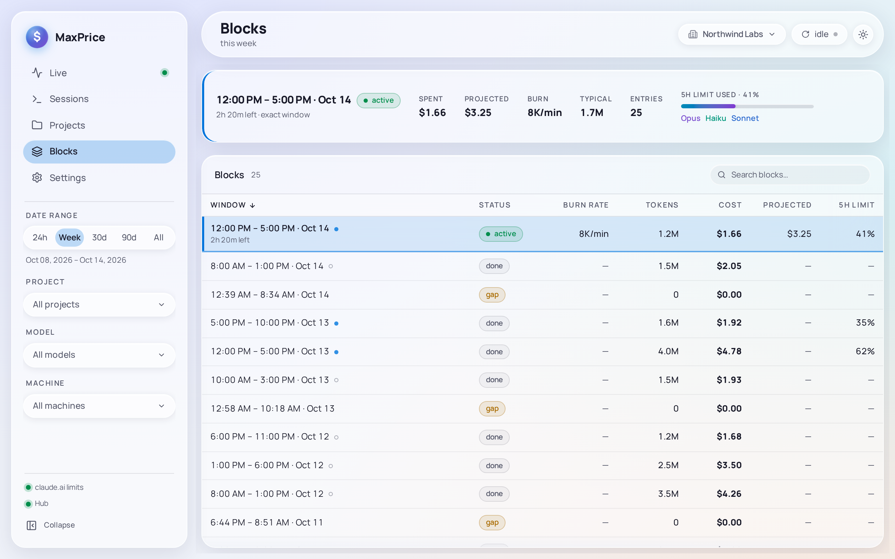

# Blocks

Blocks lists your usage one [Block](../concepts/blocks.md#blocks) to a row, newest first, with the [Active block](../concepts/blocks.md#active-block) pinned at the top. It is where to see how each Block went against your plan's [5-hour limit](../concepts/blocks.md#usage-limits).

## The table

| Column        | Shows                                                                                                        |
| ------------- | ------------------------------------------------------------------------------------------------------------ |
| **Window**    | When the window ran, as **12:00 PM – 5:00 PM · Oct 14**, and a dot telling how it was found                  |
| **Status**    | **active**, **done**, or **gap** for the time between two Blocks                                             |
| **Burn rate** | The Active block's tokens per minute. See [Burn rate](../concepts/blocks.md#burn-rate)                       |
| **Tokens**    | The window's tokens                                                                                          |
| **Cost**      | The window's cost                                                                                            |
| **Projected** | What the Active block will cost by its end. See [Projection](../concepts/blocks.md#projection)               |
| **5h limit**  | The most of your 5-hour limit claude.ai reported used in the window; the latest reading for the Active block |

A wide window adds **Cost share**. Click a column's header to sort by it, and again to reverse; the Active block stays at the top whatever the order. The Active block's row also says how long it has left, as **2h 20m left**.

**Burn rate** and **Projected** read **—** on every row but the Active block's.

### The window's dot

The dot after each window tells how MaxPrice found its edges. Hover it for its name:

- a filled dot: an **Exact window**, from the reset time claude.ai reported;
- an amber dot: a **Window ended early**, because the limits were reset ahead of schedule;
- a hollow dot: an **Estimated window**, where no limit readings cover the time. Its **5h limit** reads **—**.

[Exact, ended early and estimated windows](../concepts/blocks.md#exact-ended-early-and-estimated-windows) explains each. A **gap** row has no dot: it is the time between two Blocks, at $0 ([gaps](../concepts/blocks.md#gaps)).

## The totals

With no row selected, the Detail strip above the table sums every Block in the Date range, gaps left out: **total spent**, **total tokens**, **entries** (the requests), **active burn** (the Active block's burn rate) and the **Models** used.

Click a row for that Block's figures:

- its window and status, and how long it has left, or when it ended, and how it was found;
- **spent**, **projected** and **burn**;
- **typical**: the [Typical block](../concepts/blocks.md#typical-block)'s tokens, to compare it with;
- **entries**, its requests;
- **5h limit used**, a meter of how much of the 5-hour limit it used, and its models.

Click the row again, press **Esc**, or click outside the table to go back to the totals.

## Blocks, the filters and the Organization scope

Blocks always describe the [Quota organization](../concepts/organizations.md#quota-organization): the scoped Organization, or [Home](../concepts/organizations.md#home-organization) under **All organizations**, when the topbar's subtitle adds **· Northwind Labs's blocks**. A Block is never added across Organizations, because each has its own limits.

A [Usage limit](../concepts/blocks.md#usage-limits) covers all your work, so the Project filter does not apply to Blocks. The Model and Machine filters narrow each Block's tokens, cost and requests, but its window, status, Burn rate, Projection and 5-hour limit stay the whole Block's. The Date range keeps the Blocks that start inside it. See [Blocks and the filters](../concepts/blocks.md#blocks-and-the-filters).

A window is exact only when MaxPrice recorded limit readings for it, which takes a claude.ai [session key](../concepts/blocks.md#the-claudeai-session-key), your own or your [Hub](../concepts/hubs.md)'s. A window it has no readings for, such as one before you connected a key or while the key had expired, is estimated, and its **5h limit** reads **—**. Windows already recorded stay exact. Connect a key in [Settings › Claude account](settings.md#claude-account).
