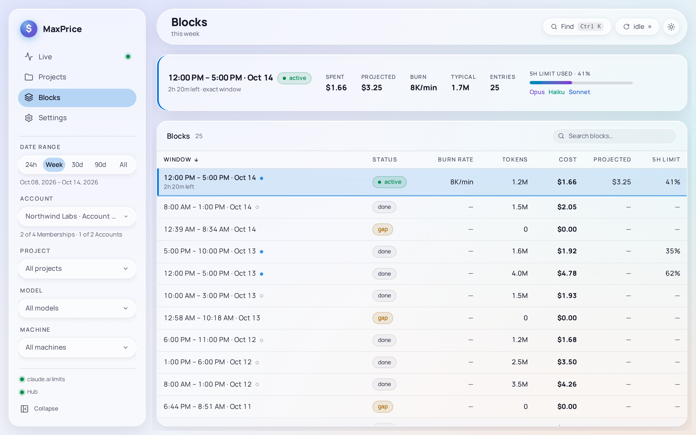

# Blocks

Blocks lists your usage one [Block](../concepts/blocks.md#blocks) to a row, newest first, with the [Active block](../concepts/blocks.md#active-block) pinned at the top. It is where to see how each Block went against your plan's [5-hour limit](../concepts/blocks.md#usage-limits).

## The table

| Column        | Shows                                                                                                        |
| ------------- | ------------------------------------------------------------------------------------------------------------ |
| **Window**    | When the window ran, as **12:00 PM – 5:00 PM · Oct 14**, and a dot telling how it was found                  |
| **Status**    | **active**, **done**, or **gap** for the time between two Blocks                                             |
| **Burn rate** | The Active block's tokens per minute. See [Burn rate](../concepts/blocks.md#burn-rate)                       |
| **Tokens**    | The window's tokens                                                                                          |
| **Cost**      | The window's cost                                                                                            |
| **Projected** | What the Active block will cost by its end. See [Projection](../concepts/blocks.md#projection)               |
| **5h limit**  | The most of your 5-hour limit claude.ai reported used in the window; the latest reading for the Active block |

A wide window adds **Cost share**. Click a column's header to sort by it, and again to reverse; the Active block stays at the top whatever the order. The Active block's row also says how long it has left, as **2h 20m left**.

**Burn rate** and **Projected** read **—** on every row but the Active block's.

### The window's dot

The dot after each window tells how MaxPrice found its edges. Hover it for its name:

- a filled dot: an **Exact window**, from the reset time claude.ai reported;
- an amber dot: a **Window ended early**, because the limits were reset ahead of schedule;
- a hollow dot: an **Estimated window**, where no limit readings cover the time. Its **5h limit** reads **—**.

[Exact, ended early and estimated windows](../concepts/blocks.md#exact-ended-early-and-estimated-windows) explains each. A **gap** row has no dot: it is the time between two Blocks, at $0 ([gaps](../concepts/blocks.md#gaps)).

## The totals

With no row selected, the Detail strip above the table sums every Block in the Date range, gaps left out: **total spent**, **total tokens**, **entries** (the requests), **active burn** (the Active block's burn rate) and the **Models** used.

Usage whose Account MaxPrice can't tell forms Blocks of its own, outside your Account's limits (see [Presumed organization](../concepts/organizations.md#presumed-organization)), so the table leaves it out. When the Date range holds some, the strip adds **account not known**: its cost and tokens. Hover it for what it counts. If your Account has no usage at all and such usage has some, the table shows that usage's Blocks instead, and the strip's line under **All blocks** ends in **account not known**.

Click a row for that Block's figures:

- its window and status, and how long it has left, or when it ended, and how it was found;
- **spent**, **projected** and **burn**;
- **typical**: the [Typical block](../concepts/blocks.md#typical-block)'s tokens, to compare it with;
- **entries**, its requests;
- **5h limit used**, a meter of how much of the 5-hour limit it used, and its models.

Click the row again, press **Esc**, or click outside the table to go back to the totals.

## A tab per Membership

With two or more Accounts tracked, once the [Scope](filters.md#the-scope) holds two or more [Memberships](../concepts/organizations.md#memberships), as under **All accounts**, Blocks gains a tab for each above the Detail strip. Each tab shows that Membership's Blocks alone, since each has its own limits.

- **The tabs** come most used first, among the Memberships with usage in the Date range, then those with none, marked **no Blocks**. Each wears its most used limit, as **82%** or **61% wk** for a weekly one, amber from 75% and red from 90%, or **idle**, **not connected**, **not readable now**, **no limits** or **key expired**; an expired key's last reading reads **· stale**, greyed. A long name is cut short from its Organization first, so the Account that tells two Memberships of one Organization apart stays in view, as do the 8 characters of id that tell two Organizations on one plan word apart (**Max plan · 1a2b3c4d**); hover a tab for its full name. The row holds up to six tabs, fewer when the window is too narrow to show each name with at least its Organization's first word, those 8 characters and its whole Account; the rest sit in an **N more** menu at the end of the row, in the same order, and a tab you pick there takes the row's last place.
- **The strip,** with no row selected, names the tab's Membership, with its plan, its count of Blocks and its range under it, as **Max plan · 18 blocks · this week**, with its **total spent**, **total tokens** and **active block**, its cost and when it resets, as **$4.20 · resets in 2h 14m**. Its **Limits** show a meter for each window, **5-hour**, **weekly** and a model's weekly limit where the plan has one, **—** for one with nothing open; **Limits · last known** when the key has expired. Without a reading they say why, as **Not connected**, **Not readable now** or **No limits**, the tab's own words.
- The Model, Machine and Date range filters apply in every tab, as below.

When the Scope holds one Membership, as it does by default, there is no tab row, and the strip still names it with its Limits. With one Account tracked, Blocks is as described above, whatever the Scope holds.

## Blocks, the filters and the Scope

With one Account tracked, Blocks describe [one Organization](../concepts/organizations.md#whose-limits-a-page-shows): the Organization the [Scope](filters.md#the-scope) holds, or [Home](../concepts/organizations.md#home)'s when the Scope spans two or more Organizations, as under **All organizations**, when the topbar's subtitle adds **· Northwind Labs's blocks**. With two or more Accounts tracked, each tab names its own Membership instead ([A tab per Membership](#a-tab-per-membership)). A Block is never added across Memberships, because each has its own limits.

A [Usage limit](../concepts/blocks.md#usage-limits) covers all your work, so the Project filter does not apply to Blocks. The Model and Machine filters narrow each Block's tokens, cost and requests, but its window, status, Burn rate, Projection and 5-hour limit stay the whole Block's. The Date range keeps the Blocks that start inside it. See [Blocks and the filters](../concepts/blocks.md#blocks-and-the-filters).

A window is exact only when MaxPrice recorded limit readings for it, which takes a claude.ai [session key](../concepts/blocks.md#the-claudeai-session-key), your own or your [Hub](../concepts/hubs.md)'s. A window it has no readings for, such as one before you connected a key or while the key had expired, is estimated, and its **5h limit** reads **—**. Windows already recorded stay exact. Connect a key in [Settings › Accounts](settings.md#connecting-an-account).
