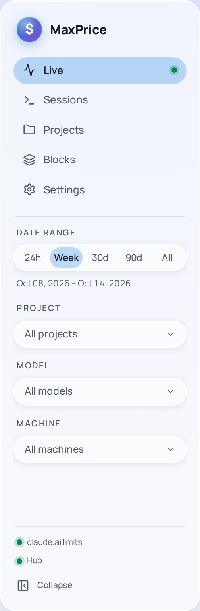
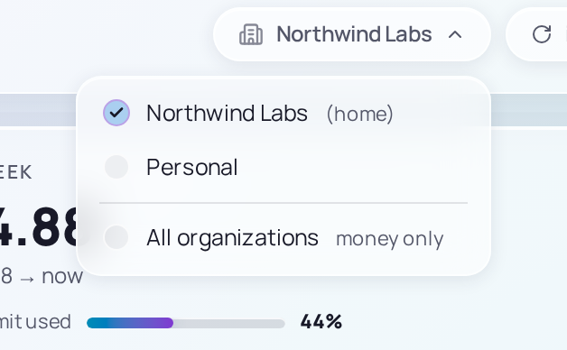

# Filters and the Organization scope

The filter rail in the sidebar narrows the reports to a Date range, to some projects, to some models and, with a Hub, to some machines. The [Organization scope](../concepts/organizations.md#organization-scope) in the topbar chooses whose usage they count. Both stay as you set them across pages and restarts.

## The filter rail

### Date range

| Preset   | Covers                                                                                                    |
| -------- | --------------------------------------------------------------------------------------------------------- |
| **24h**  | Yesterday and today, as calendar days                                                                     |
| **Week** | This week, as [Settings › Data › Week](settings.md#week) sets it: by default, today and the 6 days before |
| **30d**  | Today and the 29 days before                                                                              |
| **90d**  | Today and the 89 days before                                                                              |
| **All**  | Every day there is usage for                                                                              |

Days are counted in the timezone set in [Settings › Data](settings.md#timezone). The line under the presets shows the dates the range covers. There is no custom range.

### Project, Model and Machine

Each opens a list to tick. Tick one or more to narrow every report to them; with none ticked, or every one, the filter reads **All projects**, **All models** or **All machines**. **Clear selection** at the top of the list unticks them all.

- **Project** lists the [Projects](../concepts/projects.md) with usage in the Date range, with a search box. A project's [Worktrees](../concepts/projects.md#worktrees) and its [checkouts on other machines](../concepts/projects.md#repo-identity) come with it.
- **Model** lists the model families: Fable, Opus, Sonnet and Haiku.
- **Machine** shows only with a [Hub](../concepts/hubs.md) and its [Fleet replica](../concepts/hubs.md#fleet-replica). It lists every machine in the fleet, with yours marked **(this)**.

**Open in Live** on a project in [Projects](projects.md) sets the Project filter to that project alone.

### A narrow window

In a window narrower than the sidebar needs, or after you choose **Collapse** at the sidebar's foot, the rail folds away behind a **Filters** button. A badge on it counts the Project, Model and Machine filters in use.

## The Organization scope

While two or more [Organizations](../concepts/organizations.md) are tracked, the first chip in the topbar is the Organization scope. It reads the scoped Organization's label; click it to choose another.

- **[Home](../concepts/organizations.md#home-organization)**, marked **(home)**, which the scope starts on, and each other [Tracked organization](../concepts/organizations.md#tracked-and-excluded-organizations): every report, its cost, its tokens and its limits, is about that Organization.
- **All organizations**, marked **money only**: cost and tokens add up across every Tracked organization, while [Usage limits](../concepts/blocks.md#usage-limits) and [Blocks](../concepts/blocks.md#blocks) stay Home's. The chip then reads **All organizations** with **quota · Northwind Labs** beside it.

An Organization marked **no limits** has no limits MaxPrice can read, so its Blocks are estimated. The scope applies to every page at once, and to the [Popout](tray.md) the next time it opens. [Organization scope](../concepts/organizations.md#organization-scope) and [Quota organization](../concepts/organizations.md#quota-organization) explain the split.

Under **All organizations**, Sessions gains an **Organization** column and Projects an **Organizations** column.

## Which filter applies where

Not every filter narrows every part of every page. A Usage limit covers all your work, so nothing that measures one takes the Project filter, and the tiles on Live keep their own periods.

| Where                                       | Date range                          | Project | Model                | Machine              | Organization scope                                  |
| ------------------------------------------- | ----------------------------------- | ------- | -------------------- | -------------------- | --------------------------------------------------- |
| Live: **Today**                             | No: always today                    | Yes     | Yes                  | Yes                  | Yes                                                 |
| Live: **This week**                         | No: always this week                | Yes     | Yes                  | Yes                  | Yes; its limit is the Quota organization's          |
| Live: **Active block**                      | Only its **typical**                | No      | Cost and tokens only | Cost and tokens only | The Quota organization                              |
| Live: the cost chart                        | No: it follows its span             | Yes     | Yes                  | Yes                  | Yes; its **Block** span is the Quota organization's |
| Live: **Top sessions** and **Top projects** | Yes                                 | Yes     | Yes                  | Yes                  | Yes                                                 |
| Sessions                                    | Yes, by each session's last request | Yes     | Yes                  | Yes                  | Yes                                                 |
| Session detail                              | No                                  | No      | Yes                  | Yes                  | Yes                                                 |
| Projects                                    | Yes                                 | Yes     | Yes                  | Yes                  | Yes                                                 |
| Projects: **Cost · last 30 days**           | No: always the last 30 days         | Yes     | Yes                  | No                   | Yes                                                 |
| Blocks                                      | Yes, by each Block's start          | No      | Cost and tokens only | Cost and tokens only | The Quota organization                              |
| The Popout                                  | No                                  | No      | No                   | No                   | Yes; its limits are the Quota organization's        |

"Cost and tokens only" means the filter narrows a Block's cost, tokens and requests, but not its window, its Burn rate, its Projection or its share of the 5-hour limit ([why](../concepts/blocks.md#blocks-and-the-filters)). The Machine column applies only where the Machine filter shows.

Muting a series in the [cost chart's legend](live.md#the-legend) is not a filter: it changes that chart alone.
