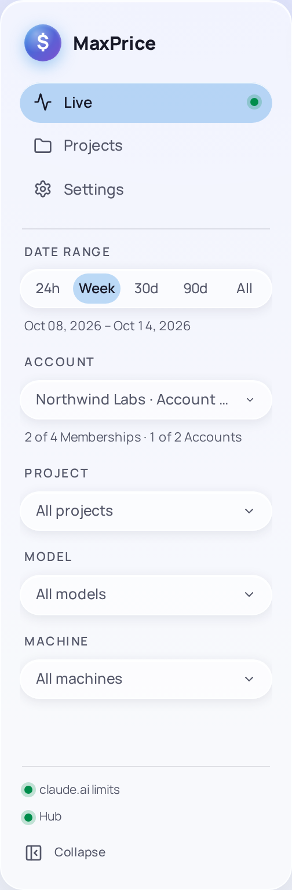
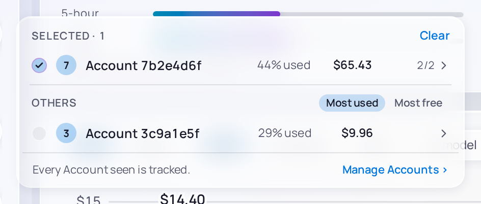

# Filters and the Scope

The filter rail in the sidebar narrows the reports to a Date range, to some projects, to some models and, with a Hub, to some machines. The [Scope](#the-scope) chooses whose usage they count: which [Memberships](../concepts/organizations.md#memberships), each one [Account](../concepts/organizations.md#accounts)'s place in one [Organization](../concepts/organizations.md). Both stay as you set them across pages and restarts.

## The filter rail

### Date range

| Preset   | Covers                                                                                                    |
| -------- | --------------------------------------------------------------------------------------------------------- |
| **24h**  | Yesterday and today, as calendar days                                                                     |
| **Week** | This week, as [Settings › Data › Week](settings.md#week) sets it: by default, today and the 6 days before |
| **30d**  | Today and the 29 days before                                                                              |
| **90d**  | Today and the 89 days before                                                                              |
| **All**  | Every day there is usage for                                                                              |

Days are counted in the timezone set in [Settings › Data](settings.md#timezone). The line under the presets shows the dates the range covers. There is no custom range.

### Project, Model and Machine

Each opens a list to tick. Tick one or more to narrow every report to them; with none ticked, or every one, the filter reads **All projects**, **All models** or **All machines**. With one ticked it reads that one's name, and with more, how many, as **2 selected**. Once anything is ticked, **Clear selection** heads the list, under its search box where it has one, and unticks them all.

- **Project** lists the [Projects](../concepts/projects.md) with usage in the Date range, with a search box. A project's [Worktrees](../concepts/projects.md#worktrees) and its [checkouts on other machines](../concepts/projects.md#repo-identity) come with it.
- **Model** lists the model families: Fable, Opus, Sonnet and Haiku.
- **Machine** shows only with a [Hub](../concepts/hubs.md) and its [Fleet replica](../concepts/hubs.md#fleet-replica). It lists every machine in the fleet, with yours marked **(this)**, and has a search box too.

**Open in Live** on a project in [Projects](projects.md) sets the Project filter to that project alone.

### A narrow window

In a window narrower than the sidebar needs, or after you choose **Collapse** at the sidebar's foot, the rail folds away behind the filters button, a sliders icon named **Filters**. A badge on it counts the Project, Model and Machine filters in use.

## The Scope

The Scope is the set of Memberships every report, tile and the [Popout](tray.md) count. It starts on your [Home membership](../concepts/organizations.md#home-membership), with the usage in Home's Organization whose Account isn't known. Cost and tokens add up across every Membership in the Scope. Usage limits never do: each Membership has its own, so with two or more Accounts tracked [Live](live.md#several-memberships) shows one card per Membership.

How you choose it depends on what this machine tracks:

| This machine tracks                      | You choose the Scope with                                     |
| ---------------------------------------- | ------------------------------------------------------------- |
| Two or more Accounts                     | The [Account filter](#the-account-filter) in the rail         |
| One Account in two or more Organizations | The [Organization chip](#the-organization-chip) in the topbar |
| One Account in one Organization          | Nothing: the Scope is that one Membership                     |

### The Account filter

While two or more [Tracked accounts](../concepts/organizations.md#accounts) are on this machine, the rail shows **Account** under the Date range. It reads what the Scope holds, as **All accounts**, an Account's label, or **Northwind Labs · Account 7b2e4d6f** for one Membership, and the line under it counts the boxes it ticks, **Account not known** included, as **2 of 4 Memberships · 1 of 2 Accounts**. Click it to open the Account menu.

Each row is a tracked Account: a box to tick, its label (and its email, when MaxPrice knows it), how much of its limits it has used, and its cost in the Date range under the other filters. Its use is its most used Membership's most used limit window; **no limits read** means none of its Memberships has a limit MaxPrice can read. The figure turns amber from 75% and red from 90%.

- **Tick an Account** to add all its Memberships to the Scope, or untick it to take them out. The chevron at its right, with a count such as **2/2** when it has several, opens its Memberships, one row per Organization, Home marked **⌂ Home**, each with its own box.
- **only**, on any row, makes the Scope that Account or that Membership alone.
- **Selected · N**, at the top, holds the Accounts the Scope includes. **Clear** beside it returns to every Account: the Scope then holds every tracked Membership, the menu heads its list **All accounts**, and the Selected section goes.
- **Others** lists the rest. **Most used** ranks them with the highest use first; **Most free** with the most room left first. Accounts with no limits read come last.
- **Search and the fold.** With more than six Accounts, a search box finds an Account by its label or email, or by one of its Organizations, which opens that Account's matching Memberships. The list then shows the top five and folds the rest under one line, as **4 more · none above 32% used**, or under **Most free** **4 more · none more than 68% free** (**· 2 with no limits read** when some have none); click it to show them all, and **Show the top 5** to fold them again.
- **Pending accounts.** An [Account](../concepts/organizations.md#accounts) MaxPrice knows only by an email has an **@** in place of its letter and reads **Known by email only**. It is ticked and counted like any other.
- **Account not known.** When the Date range holds usage whose Account MaxPrice can't tell, or the Scope counts such usage, a last row, **Account not known**, holds it, with one Membership per Organization, at **$0.00** where the Date range has none. The default Scope ticks the one in Home's Organization, and **All accounts** every Organization's, so nothing counts without a ticked box. Tick it to count that usage too. An Account you tick never includes it, so ticking every row is exactly **All accounts**.

The footer counts the Accounts MaxPrice has seen but doesn't track, which the menu leaves out, or reads **Every Account seen is tracked.** **Manage Accounts ›** opens [Settings](settings.md#accounts), where you track them under **Claude**.

The menu's costs follow the Date range and the other filters, never the Scope, so you can see what an Account would add before you tick it.

A **Provider** switch, **All** or **Claude** or another, sits above the Account filter once your Tracked accounts span two Providers. Claude is the only Provider today, so the switch doesn't show yet.

### The Organization chip

While one Account is tracked and it is in two or more [Organizations](../concepts/organizations.md), the Organization chip, beside **Find** in the topbar, chooses the Scope by Organization, as it always has. It reads the chosen Organization's label; click it to choose another.

- **[Home](../concepts/organizations.md#home)**, marked **(home)**, which the chip starts on, and each other [Tracked organization](../concepts/organizations.md#tracked-and-excluded-organizations): every report, its cost, its tokens and its limits, is about that Organization.
- **All organizations**, marked **money only**: cost and tokens add up across every Tracked organization, while [Usage limits](../concepts/blocks.md#usage-limits) and [Blocks](../concepts/blocks.md#blocks) stay Home's. The chip then reads **All organizations** with **quota · Northwind Labs** beside it.

An Organization marked **no limits** has no limits MaxPrice can read, so its Blocks are estimated. [Whose limits a page shows](../concepts/organizations.md#whose-limits-a-page-shows) explains the split.

Once you track a second Account the chip goes, and the Account filter takes its place.

### A saved selection not applied

If you go back to one Account after choosing Accounts or Memberships in the Account filter, MaxPrice keeps that choice but counts the Home membership until you track a second Account again, since nothing on screen could show or undo it. The topbar says so: the Organization chip carries an info mark and its menu opens with the reason, or, with no chip, a **Saved selection not applied** note stands in its place. Picking a choice in the chip replaces the kept one.

### Where the Scope shows

The Scope applies to every page at once, and to the Popout the next time it opens. Whenever it holds more than one Membership:

- while it spans two or more Organizations, Projects gains an **Organizations** column;
- with two or more Accounts tracked, Live splits its Today and This week tiles by Account or by Organization, and shows a card per Membership in place of the Active block tile ([Live](live.md#several-memberships)), with a picker for whose Block the chart's **Block** span frames; Blocks shows a tab per Membership ([Blocks](blocks.md#a-tab-per-membership)); and the Popout a row per Membership, and the tray icon the most used one's limit ([Tray](tray.md#the-figure-with-several-memberships)). With one Account, Live's tiles, Blocks, the Popout and the tray icon's figure stay as they are;
- on Windows, the tray icon's tooltip says what today's cost adds up: **(all accounts)**, **(all organizations)** or, for any other set, **(3 memberships)** ([Tray](tray.md#the-tray-icon)).

## Which filter applies where

Not every filter narrows every part of every page. A Usage limit covers all your work, so nothing that measures one takes the Project filter, and the tiles on Live keep their own periods.

| Where                                       | Date range                          | Project | Model                 | Machine               | Scope                                                                      |
| ------------------------------------------- | ----------------------------------- | ------- | --------------------- | --------------------- | -------------------------------------------------------------------------- |
| Live: **Today**                             | No: always today                    | Yes     | Yes                   | Yes                   | Yes                                                                        |
| Live: **This week**                         | No: always this week                | Yes     | Yes                   | Yes                   | Yes; its weekly meter is one Organization's                                |
| Live: **Active block**                      | Only its **typical**                | No      | Cost and tokens only  | Cost and tokens only  | One Organization; with two or more Accounts tracked, a card per Membership |
| Live: the cost chart                        | No: it follows its span             | Yes     | Yes                   | Yes                   | Yes; its **Block** span is one Organization's, or the picked Membership's  |
| Live: **Top sessions** and **Top projects** | Yes                                 | Yes     | Yes                   | Yes                   | Yes                                                                        |
| Session detail                              | No                                  | No      | Yes, except from Find | Yes, except from Find | Yes, except from Find                                                      |
| Projects                                    | Yes                                 | Yes     | Yes                   | Yes                   | Yes                                                                        |
| Projects: **Cost · last 30 days**           | No: always the last 30 days         | Yes     | Yes                   | No                    | Yes                                                                        |
| Projects: a project's sessions              | Yes, by each session's last request | Yes     | Yes                   | Yes                   | Yes                                                                        |
| Blocks                                      | Yes, by each Block's start          | No      | Cost and tokens only  | Cost and tokens only  | One Organization; with two or more Accounts tracked, a tab per Membership  |
| The Popout                                  | No                                  | No      | No                    | No                    | Yes; its limits are one Organization's, or a row per Membership            |
| Find                                        | Yes                                 | No      | No                    | No                    | No: every tracked Membership                                               |

In the Scope column, "one Organization" is the Organization whose limits and Blocks a surface shows with one Account tracked: the Scope's, or Home's when the Scope spans two or more ([whose limits](../concepts/organizations.md#whose-limits-a-page-shows)); "a card", "a tab" and "a row per Membership" apply with two or more tracked and a Scope of two or more Memberships. "Cost and tokens only" means the filter narrows a Block's cost, tokens and requests, but not its window, its Burn rate, its Projection or its share of the 5-hour limit ([why](../concepts/blocks.md#blocks-and-the-filters)). The Machine column applies only where the Machine filter shows.

Muting a series in the [cost chart's legend](live.md#the-legend) is not a filter: it changes that chart alone.
