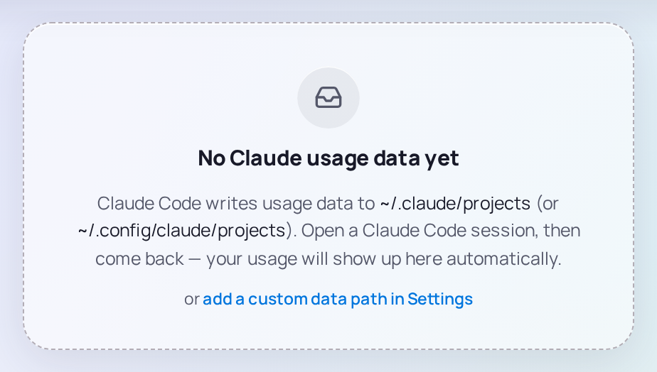

# First run

The first time MaxPrice opens, it reads all of Claude Code's session logs on your computer. Then it opens on Live, and from there it keeps up as Claude Code writes.

## Reading your logs

While it starts, MaxPrice shows its progress: **Starting the engine**, then **Finding session files** and **Reading session files** with a count of files read, then **Rendering your usage**. With a [Hub](../concepts/hubs.md)'s [Fleet replica](../concepts/hubs.md#fleet-replica) it also shows **Merging fleet history**. The first start parses every log, so it takes longest; later starts reuse what they parsed before.

It reads the folders listed in Settings › **Claude data paths**: by default `~/.claude/projects` and `~/.config/claude/projects`, the two places Claude Code writes its logs.

## No usage yet

If those folders hold no usage, every report shows **No Claude usage data yet**:

- **You haven't used Claude Code on this computer yet.** Open a session. Your usage shows up on its own; there is nothing to refresh.
- **Claude Code writes its logs somewhere else.** Choose **add a custom data path in Settings**, then **Add path** under **Claude data paths**, and pick the `projects` folder Claude Code writes its logs into.

## Connect your claude.ai account

Cost and tokens need nothing more. To see your real 5-hour and weekly [usage limits](../concepts/blocks.md#usage-limits), give MaxPrice your [claude.ai session key](../concepts/blocks.md#the-claudeai-session-key):

1. Copy the key from your browser, as that page describes.
2. Open Settings › **Claude account**, paste it into the key field and choose **Connect**.

The status above the field then reads **Connected**, and Live's tiles show how much of each limit you have used. Without a key, the limit meters don't show and every [Block](../concepts/blocks.md#blocks) is estimated. A computer [joined to a Hub](join-a-hub.md) reads the Hub's limits instead, but it still needs a key of its own to read them whenever it [can't reach the Hub](../concepts/hubs.md#fallback-polling).

## Check your Organization

MaxPrice picks a [Home organization](../concepts/organizations.md#home-organization) on its first run: the [Organization](../concepts/organizations.md) that owns the most sessions on this computer. If MaxPrice has seen only one on this computer, there is nothing to check.

With two or more, open Settings › **Claude account** after the first run. It lists each Organization MaxPrice has seen, Home marked and each other one with a switch: on for a [Tracked organization](../concepts/organizations.md#tracked-and-excluded-organizations), off for an Excluded one. Every Organization but Home starts with its switch off, so its usage is not counted until you track it.

## After the first run

- On macOS and Windows, MaxPrice puts an icon in the menu bar or the notification area, and closing the window hides it while MaxPrice keeps running. See [Tray and Popout](tray.md), which also covers **Start at login**.
- [Live](live.md) is the page it opens on.
- To see several computers' usage together, [join a Hub](join-a-hub.md).
