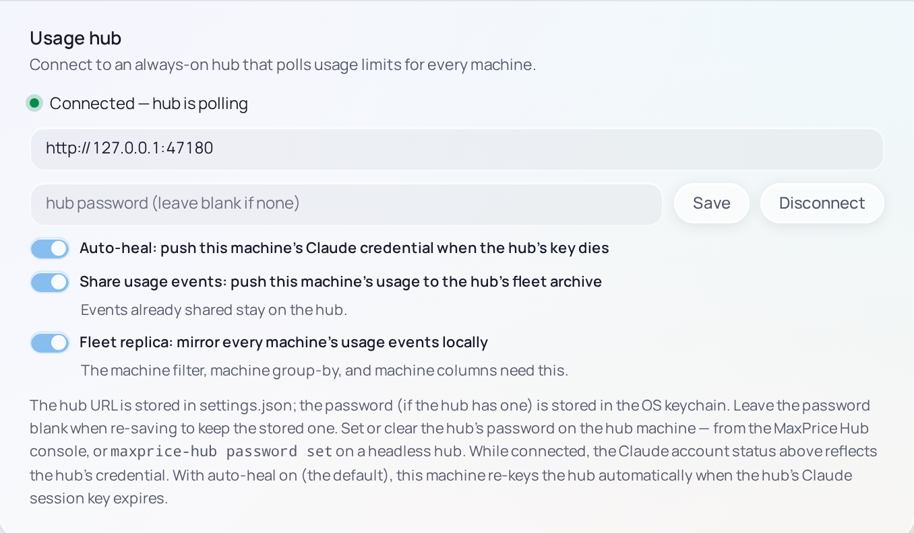

# Join a Hub

Join the Desktop client to a [Hub](../concepts/hubs.md) to see the usage of every computer you run Claude Code on, and to let the Hub read your usage limits for all of them. Joining takes the Hub's address, and its password if it has one.

## Before you join

You need a Hub running on a computer that stays on: the [Hub tray app](../hub-tray-app/overview.md) on Windows, or the [Headless Hub](../headless-hub/overview.md) on a Linux server. Each computer reaches it over your [tailnet](../concepts/hubs.md#tailnet), so this computer must be on the same one.

The Hub's address is its computer's Tailscale name or address and the port, as `http://my-desktop.tailnet.ts.net:47100`. The Hub tray app's console shows it as **Listening** (see [Join clients](../hub-tray-app/join-clients.md)).

> [!NOTE]
> A Hub counts the Desktop client and the [Headless client](../headless-client/overview.md) on one computer as two machines. Join only one of them.

## Join

1. Open Settings › **Usage hub**.
2. Type the Hub's address. Without `http://` MaxPrice adds it, and without a port it uses 47100.
3. If the Hub has a [Hub password](../concepts/hubs.md#hub-password), type it in **hub password**. Otherwise leave that field blank.
4. Choose **Connect**.

The status line above the address reads **Connected — hub is polling** once the Hub answers.

The first time, MaxPrice copies the other machines' usage from the Hub, and a **Syncing fleet history** bar shows how far it has got. Once it is done, every report can show each machine's usage: Live's chart can be grouped **by machine**, and a **Machine** filter appears (see [the Machine filter](../concepts/hubs.md#the-machine-filter-and-grouping-by-machine)).

While you are joined, Settings › Claude account shows the state of the Hub's [session key](../concepts/blocks.md#the-claudeai-session-key), not this computer's. Keep a key of your own anyway: this computer reads your limits with it whenever it [can't use the Hub](../concepts/hubs.md#fallback-polling).

## The three switches

Under the password are three switches, each on by default: [Auto-heal](../concepts/hubs.md#auto-heal), [Share usage events](../concepts/hubs.md#share-usage-events) and [Fleet replica](../concepts/hubs.md#fleet-replica). Leave them on unless you have a reason not to; [Hubs and the fleet](../concepts/hubs.md#the-clients-switches) explains what each one does and what turning it off changes.

> [!WARNING]
> If the address isn't a tailnet or loopback one, MaxPrice warns under it. Traffic to a Hub isn't encrypted, and with **Auto-heal** on your session key may be sent to that address. Join a Hub over your tailnet.

## Change the address or password

Edit the address and choose **Save**. Leave the password field blank to keep the password MaxPrice already has, or type a new one. MaxPrice keeps the address in its settings and the password in the system's keychain.

A Hub's password is set on the Hub's computer, not here: in the Hub tray app's console, or with `maxprice-hub password set` on a Headless Hub ([reference](../../../hub/README.md#the-hub-password)).

## Leave the Hub

Choose **Disconnect**. MaxPrice forgets the address and the password, stops syncing, and reads your limits with its own session key again. What this computer already sent stays on the Hub.

## If it doesn't connect

The status line says what is wrong, each ending **polling locally**: the Hub is unreachable, has no working claude.ai key, rejected the password, or runs a different version. [Troubleshooting](troubleshooting.md#the-hub-doesnt-connect) covers each one.
