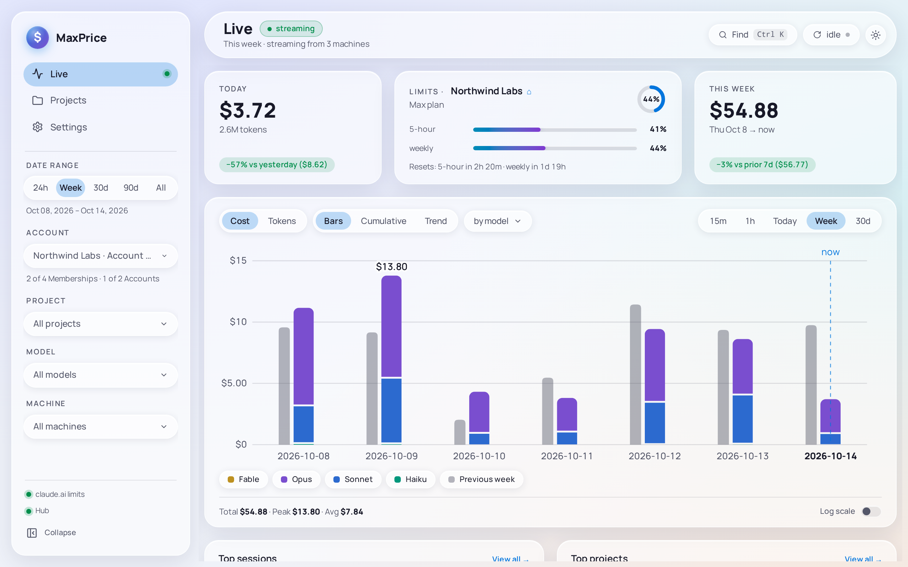
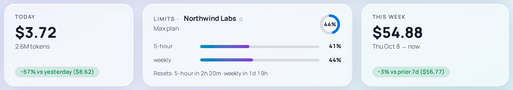

# Live

Live is the page the Desktop client opens on. It shows what you have spent today and this week, your [Usage limits](../concepts/usage-limits.md) as claude.ai reports them, a chart of your cost over time, and your top sessions and projects. It updates as Claude Code writes its logs, with nothing for you to do.

The topbar's title carries the stream's state: **streaming** while new usage arrives as it is written, **reconnecting** or **offline** when the window has lost the engine that reads the logs. Under the title, the Date range and where the usage comes from: **This week · streaming from this machine**, or **streaming from 3 machines** with a [Hub](../concepts/hubs.md) and its [Fleet replica](../concepts/hubs.md#fleet-replica). While the Fleet replica first copies the Hub's history it reads **This week · Syncing fleet history — 40%**, and while the engine is too busy to keep up, **This week · catching up…**, which clears by itself.

Until Claude Code has written any usage, Live reads **No Claude usage data yet** instead. If your logs are somewhere other than `~/.claude/projects` or `~/.config/claude/projects`, add their folder in [Settings › Data › Claude data paths](settings.md#claude-data-paths).

## The tiles

### Today

Today's cost and tokens since local midnight, in the timezone set in [Settings › Data](settings.md#timezone). The chip under it compares today so far with all of yesterday, as **−57% vs yesterday ($8.62)**: amber when you are spending more, green when less.

### This week

This week's cost. What a week is follows [Settings › Data › Week](settings.md#week): the last 7 days by default, shown as **Thu Oct 8 → now**. The chip compares it with the 7 days before, or with the previous week up to the same point when the week starts at your limit reset or at a time you set.

With the week set to start at your limit reset, it reads **⚠ weekly reset unknown — showing last 7 days** until claude.ai has reported a reset time. Where the Organization whose limits Live shows has no weekly limit, or its limits can't be read with your key, it reads **last 7 days** instead, since there is no reset to wait for.

### The limit card

Between the two, the limit card shows your [Usage limits](../concepts/usage-limits.md) as claude.ai reports them, for one [Membership](../concepts/organizations.md#memberships): **Limits ·** and its Organization, with its plan under the name, as **Max plan** or **Ultra plan**. A ring shows its most used limit. Under it, a meter for each limit the plan has:

- **5-hour**, the share of your plan's 5-hour limit used;
- **weekly**, the share of your weekly limit;
- **weekly · Fable**, or another model, where the plan limits that model on its own.

A line under them says when they reset, as **Resets: 5-hour in 2h 20m · weekly in 1d 19h**. A limit with no window open, as between two 5-hour windows, reads **—** on an empty bar, and with no window open at all the line reads **No limit window open**. A plan with no 5-hour limit, as some Ultra plans are, shows no 5-hour meter and reads **no 5-hour limit on this plan**.

The card shows its limits only while MaxPrice can read them: once you connect a [session key](../concepts/usage-limits.md#the-claudeai-session-key) in [Settings › Claude](settings.md#connecting-an-account), or while you are joined to a Hub that has one. Otherwise it reads, as a card of [the limit area](#the-limit-area) does, **not connected** or **not readable now**; and when the key expires, **key expired · last known**, with the last reading greyed and **Reconnect**, which opens that Account's Connect. With no Account to read at all, it reads **No limits read — connect an Account in Settings.**

The card describes one Membership's limits: the Scope's, or Home's when the Scope spans two or more Organizations ([whose limits](../concepts/organizations.md#whose-limits-a-page-shows)). With one Account it stays under every choice in the [Organization chip](filters.md#the-organization-chip), **All organizations** included, where it is Home's. With two or more Accounts tracked, once the [Scope](filters.md#the-scope) holds two or more Memberships a card per Membership takes its place ([below](#the-limit-area)).

## Several Memberships

While the [Scope](filters.md#the-scope) holds one [Membership](../concepts/organizations.md#memberships), as it does by default, Live is as above. With one Account tracked it stays as above whatever the Scope holds: the Organization chip's **All organizations** adds up the money in Today, This week and the chart, and changes no tile. With two or more Accounts tracked, once the Scope holds two or more Memberships, as when you tick a second Account in the [Account filter](filters.md#the-account-filter), the tiles change:

### The split bars

Today and This week gain a bar under their cost, split by where the money went, with a legend of each part's cost:

- **by Account**, while the Scope's Memberships belong to two or more Accounts. Usage whose Account MaxPrice can't tell gets a part of its own, **Account not known**, when there is some;
- **by Organization**, while they are one Account's Memberships in two or more Organizations;
- no bar while the Scope is one Membership.

Up to four parts are named; past four, the three largest are, and the rest fold into one part, as **2 more**. The parts' widths follow their exact costs. The legend's figures are rounded so that they always add up to the tile's figure to the cent, which can put a part a cent away from its own rounded cost; hover a part for its exact figure, unrounded. The tile's own figure is always the exact total.

### The limit area

Usage limits are never added across Memberships, so Live shows each Membership's own, most used first, on a row under Today and This week:

| Memberships in the Scope | What shows                                        |
| ------------------------ | ------------------------------------------------- |
| One                      | [The limit card](#the-limit-card), between them   |
| Two to four              | A card for each                                   |
| Five or more             | One board, **Limits · N Memberships**, a row each |

Each card is the one-Membership card without its **Limits ·**: it names its Organization, with **⌂** for the [Home membership](../concepts/organizations.md#home-membership), and under it its Account while the cards span two or more Accounts, and its plan. A ring shows its most used limit, then a meter for each window, **5-hour** and **weekly** (and a model's weekly limit where the plan has one), and one line for when they reset. A plan with no 5-hour limit reads **no 5-hour limit on this plan**. A card can also read:

- **key expired · last known**: its Account's session key expired. The card keeps its last reading, greyed, with when it was read and **Reconnect**, which opens that Account's Connect in [Settings › Claude](settings.md#connecting-an-account);
- **not connected**: no session key reads this Account. **Settings** opens that Account's Connect in Settings › Claude;
- **not readable now**: there is a key, but claude.ai gave no reading;
- **No usage limits reported.**: the Organization has no limit MaxPrice can read.

With five or more Memberships, the board lists the four most used, one row each with its **5h** and **week** meters and when its most used limit resets, as **5-hour resets in 2h 20m**. A line under them sums up the rest, as **3 more, none above 22%**, or **3 more, 1 at 90% or more** when some are close to a limit, and counts those whose limits can't be read, as **2 not readable**. **Show all** lists every row in place, and **Show fewer** goes back to four.

## The cost chart

The chart's own controls run along its top:

| Control                             | What it does                                                                                           |
| ----------------------------------- | ------------------------------------------------------------------------------------------------------ |
| **Cost** / **Tokens**               | What the chart measures.                                                                               |
| **Bars**, **Cumulative**, **Trend** | One bar per period; a running total; or a moving average that smooths out single busy periods.         |
| **by model**                        | Which series each bar or line stacks. See [Grouping](#grouping).                                       |
| **15m** to **30d**                  | The span: how much time the chart covers, which is independent of the Date range. See [Spans](#spans). |

Under the chart, **Total**, **Peak** and **Avg** sum what is drawn, and **Log scale** draws the y-axis in powers of ten, so a small model stays legible beside a large one. Log scale draws lines, and needs the chart grouped by model or by token type.

Hover a bar or a point for each series' figure in that period, and their total.

### Spans

| Span      | Covers                                       | One bar per |
| --------- | -------------------------------------------- | ----------- |
| **15m**   | the last 15 minutes                          | minute      |
| **1h**    | the last hour                                | minute      |
| **Today** | since local midnight                         | hour        |
| **Week**  | this week, as Settings › Data › Week sets it | day         |
| **30d**   | the last 30 days                             | day         |

**Cumulative** and **Trend** work in 15-minute steps on **Week** and **30d**, and in steps of a minute or two on the shorter spans. A chart left on the **Block** span by an earlier version opens on **Today**.

### Grouping

The **by model** menu groups the chart **by machine**, **by model**, **by project** or **by token type**, or by two or more at once, as **by model + token type**. Whatever order you pick them in, the first of them in the menu's order sets each series' colour and the next its shade. Clear every choice for a single series. **by project** shows the five most expensive projects, or three beside another choice, and puts the rest under **Other**. **by machine** is there only with a Hub and the Fleet replica; the [Hubs page](../concepts/hubs.md#the-machine-filter-and-grouping-by-machine) shows it.

### The legend

Each series has a chip in the legend under the chart. Click a chip to mute that series: it leaves the chart, and Total, Peak and Avg leave it out, until you click it again. Muting changes only this chart, never the tiles, the other pages or the filters.

The last chip, **Previous week** (or **Yesterday**, **Previous 30d**, after the span), turns the grey bars of the previous period on or off.

## Top sessions and Top projects

Under the chart, the five sessions and the five [projects](../concepts/projects.md) that cost the most in the Date range. Either **View all →** opens [Projects](projects.md), where each project lists [its sessions](projects.md#a-projects-sessions).

## Reading the logs again

MaxPrice watches Claude Code's logs and updates by itself. The pill at the topbar's right says how fresh the numbers are: **live · just now** or **live · 12s ago** after new usage, **idle** when nothing has arrived for a minute, and **reconnecting…** or **offline** when the window has lost the engine.

Click the pill, or press **Shift+R** anywhere outside a text field, to read every log again now. It reads **refreshing…**, then **refreshed · +N** with the number of new requests it found, or **up to date**.

The foot of the sidebar shows anything that needs attention, each with a dot: **claude.ai limits** and **Hub** with their state on hover (the limits' also says how long ago they were last read), **Session expired** when the session key needs replacing, **engine catching up** while a burst of usage is being read, and **watcher stalled** if MaxPrice stopped seeing new usage, which may not appear until you read the logs again.

## The filters

The filter rail in the sidebar narrows Live, but not every part of it in the same way. Today and This week keep their own periods and ignore the Date range; the chart follows its span; the limit card shows what claude.ai reports, which no filter narrows. [Filters and the Scope](filters.md#which-filter-applies-where) has the whole table.
