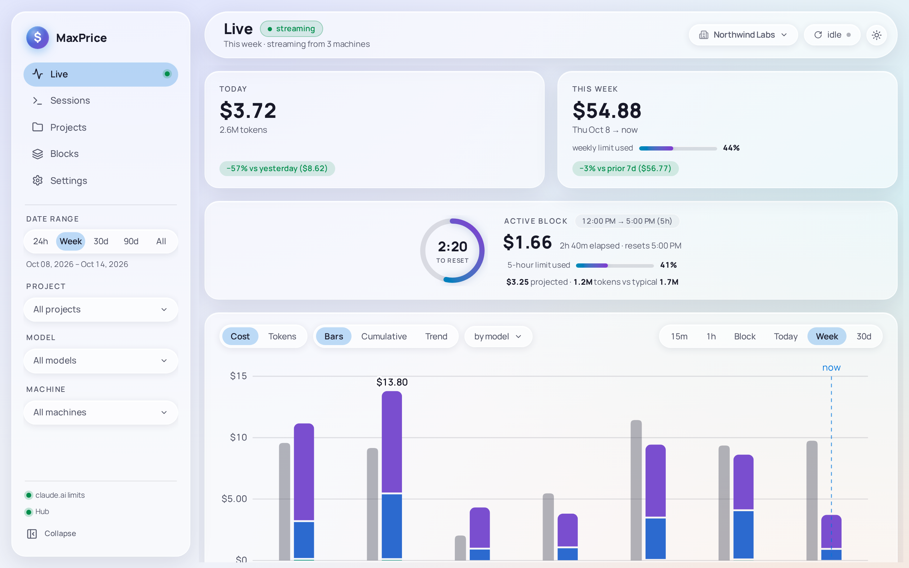
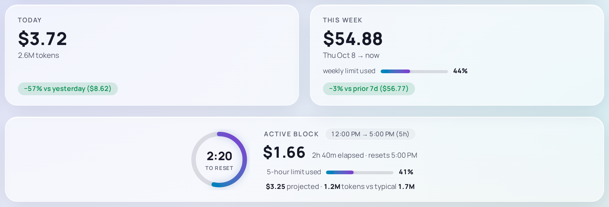
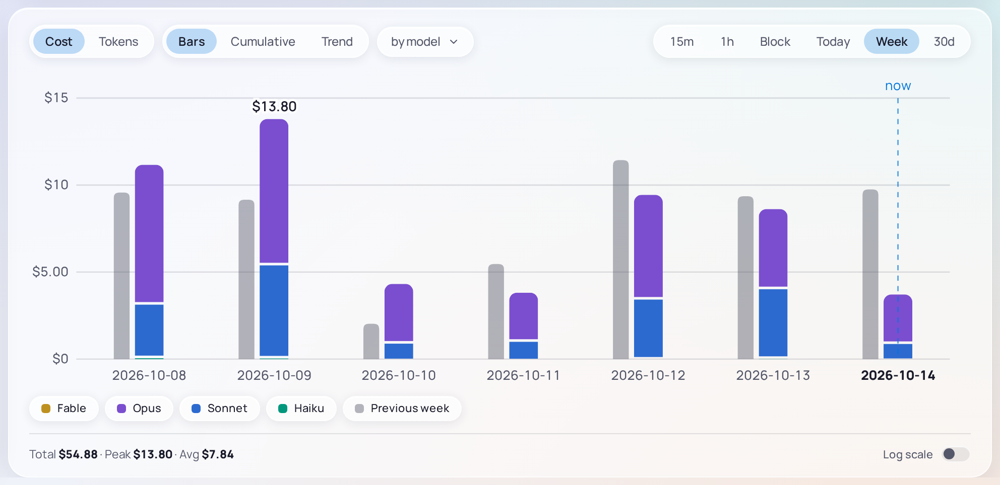

# Live

Live is the page the Desktop client opens on. It shows what you have spent today, this week and in the current Block, a chart of your cost over time, and your top sessions and projects. It updates as Claude Code writes its logs, with nothing for you to do.

The topbar's title carries the stream's state: **streaming** while new usage arrives as it is written, **reconnecting** or **offline** when the window has lost the engine that reads the logs. Under the title, the Date range and where the usage comes from: **This week · streaming from this machine**, or **streaming from 3 machines** with a [Hub](../concepts/hubs.md) and its [Fleet replica](../concepts/hubs.md#fleet-replica).

Until Claude Code has written any usage, Live reads **No Claude usage data yet** instead. If your logs are somewhere other than `~/.claude/projects` or `~/.config/claude/projects`, add their folder in [Settings › Data › Claude data paths](settings.md#claude-data-paths).

## The tiles

### Today

Today's cost and tokens since local midnight, in the timezone set in [Settings › Data](settings.md#timezone). The chip under it compares today so far with all of yesterday, as **−57% vs yesterday ($8.62)**: amber when you are spending more, green when less.

### This week

This week's cost. What a week is follows [Settings › Data › Week](settings.md#week): the last 7 days by default, shown as **Thu Oct 8 → now**. The chip compares it with the 7 days before, or with the previous week up to the same point when the week starts at your limit reset or at a time you set.

Once MaxPrice reads your [Usage limits](../concepts/blocks.md#usage-limits), the tile shows **weekly limit used** as a meter and a percentage. With the week set to start at your limit reset, it reads **⚠ weekly reset unknown — showing last 7 days** until claude.ai has reported a reset time.

### Active block

The [Active block](../concepts/blocks.md#active-block) is the Block you are in now. The ring fills as the window passes and counts down to its reset, with the window's times beside its title, as **12:00 PM → 5:00 PM (5h)**. Under them:

- the cost so far, with how long the window has run and when it resets;
- **5-hour limit used**, a meter and a percentage of your plan's 5-hour limit;
- the [Projection](../concepts/blocks.md#projection), as **$3.25 projected**, and the window's tokens against the [Typical block](../concepts/blocks.md#typical-block)'s, as **1.2M tokens vs typical 1.7M**.

With no Active block, the tile reads **No active block — start a Claude Code session to open one.** The window adds **est.** when the Quota organization reports no 5-hour limit, or its limits can't be read with your key: its Blocks are then [estimated](../concepts/blocks.md#estimated-blocks-on-the-active-block-tile).

### The limit meters

The two meters show only while MaxPrice can read your limits: once you connect a [session key](../concepts/blocks.md#the-claudeai-session-key) in [Settings › Claude account](settings.md#claude-account), or while you are joined to a Hub that has one. When the key expires, the tiles read **⚠ Session expired — reconnect →**, which opens Settings.

They describe the [Quota organization](../concepts/organizations.md#quota-organization). Where the [Organization scope](../concepts/organizations.md#organization-scope) is **All organizations**, the tiles name it, as **Active block · Northwind Labs** and **weekly limit used · Northwind Labs**. This week's cost still adds up every [Tracked organization](../concepts/organizations.md#tracked-and-excluded-organizations), but the Active block's cost is the Quota organization's alone, since a Block belongs to one Organization.

## The cost chart

The chart's own controls run along its top:

| Control                             | What it does                                                                                           |
| ----------------------------------- | ------------------------------------------------------------------------------------------------------ |
| **Cost** / **Tokens**               | What the chart measures.                                                                               |
| **Bars**, **Cumulative**, **Trend** | One bar per period; a running total; or a moving average that smooths out single busy periods.         |
| **by model**                        | Which series each bar or line stacks. See [Grouping](#grouping).                                       |
| **15m** to **30d**                  | The span: how much time the chart covers, which is independent of the Date range. See [Spans](#spans). |

Under the chart, **Total**, **Peak** and **Avg** sum what is drawn, and **Log scale** draws the y-axis in powers of ten, so a small model stays legible beside a large one. Log scale draws lines, and needs the chart grouped by model or by token type.

Hover a bar or a point for each series' figure in that period, and their total.

### Spans

| Span      | Covers                                       | One bar per |
| --------- | -------------------------------------------- | ----------- |
| **15m**   | the last 15 minutes                          | minute      |
| **1h**    | the last hour                                | minute      |
| **Block** | the Active block, from its start to now      | minute      |
| **Today** | since local midnight                         | hour        |
| **Week**  | this week, as Settings › Data › Week sets it | day         |
| **30d**   | the last 30 days                             | day         |

**Cumulative** and **Trend** work in 15-minute steps on **Week** and **30d**, and in steps of a minute or two on the shorter spans. The **Block** span reads **No active block** until a window opens. Under All organizations it shows the Quota organization's window, and says so, as **Northwind Labs's block**.

### Grouping

The **by model** menu groups the chart **by machine**, **by model**, **by project** or **by token type**, or by two or more at once, as **by model + token type**. Whatever order you pick them in, the first of them in the menu's order sets each series' colour and the next its shade. Clear every choice for a single series. **by project** shows the five most expensive projects, or three beside another choice, and puts the rest under **Other**. **by machine** is there only with a Hub and the Fleet replica; the [Hubs page](../concepts/hubs.md#the-machine-filter-and-grouping-by-machine) shows it.

### The legend

Each series has a chip in the legend under the chart. Click a chip to mute that series: it leaves the chart, and Total, Peak and Avg leave it out, until you click it again. Muting changes only this chart, never the tiles, the other pages or the filters.

The last chip, **Previous week** (or **Yesterday**, **Previous block**, **Previous 30d**, after the span), turns the grey bars of the previous period on or off.

## Top sessions and Top projects

Under the chart, the five sessions and the five [projects](../concepts/projects.md) that cost the most in the Date range. **View all →** opens [Sessions](sessions.md) or [Projects](projects.md).

## Reading the logs again

MaxPrice watches Claude Code's logs and updates by itself. The pill at the topbar's right says how fresh the numbers are: **live · just now** or **live · 12s ago** after new usage, **idle** when nothing has arrived for a minute, and **reconnecting…** or **offline** when the window has lost the engine.

Click the pill, or press **Shift+R** anywhere outside a text field, to read every log again now. It reads **refreshing…**, then **refreshed · +N** with the number of new requests it found, or **up to date**.

The foot of the sidebar shows anything that needs attention, each with a dot: **claude.ai limits** and **Hub** with their state on hover, **Session expired** when the session key needs replacing, **engine catching up** while a burst of usage is being read, and **watcher stalled** if MaxPrice stopped seeing new usage, which may not appear until you read the logs again.

## The filters

The filter rail in the sidebar narrows Live, but not every part of it in the same way. Today and This week keep their own periods and ignore the Date range; the chart follows its span; the Active block ignores the Project filter. [Filters and the Organization scope](filters.md#which-filter-applies-where) has the whole table.
