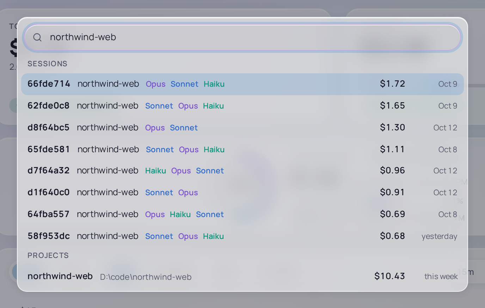

# Overview

The Desktop client is the MaxPrice app. It reads the session logs Claude Code writes on your computer and shows, in a window, what that use would cost at API prices and how close you are to your plan's usage limits.

## Platforms

| System  | Download                                                     | Tray and Popout | Updates itself |
| ------- | ------------------------------------------------------------ | --------------- | -------------- |
| macOS   | One `.dmg` for Apple Silicon and Intel, signed and notarized | Yes             | Yes            |
| Windows | An `.exe` installer for x64, not code-signed                 | Yes             | Yes            |
| Linux   | A `.deb` for x64, for Debian, Ubuntu and their derivatives   | No              | No             |

On a Linux server with no desktop, or a Mac that nobody sits at, use the [Headless client](../headless-client/overview.md) instead.

## What it shows

The sidebar holds three reports and Settings:

- [Live](live.md): today's and this week's cost, the [Active block](../concepts/blocks.md#active-block), your [usage limits](../concepts/blocks.md#usage-limits) and a cost chart.
- [Projects](projects.md): your usage by [project](../concepts/projects.md), each project's Claude Code sessions, and the [detail](projects.md#session-detail) of one session.
- [Blocks](blocks.md): your usage by [Block](../concepts/blocks.md#blocks), the 5-hour periods your plan limits.
- [Settings](settings.md): where the logs are read from, your [claude.ai session key](../concepts/blocks.md#the-claudeai-session-key), a [Hub](../concepts/hubs.md), and the app itself.

The [filters](filters.md) and the [Scope](filters.md#the-scope), which chooses whose usage counts by [Account and Organization](../concepts/organizations.md), narrow every report. **Find**, at the topbar's right, finds a session, a project or a setting from any page: see [Find](#find).

On macOS and Windows a tray icon stays in the menu bar or notification area, with a small Popout of your limits and today's cost. By default, closing the window hides it and leaves MaxPrice running, with the tray icon as your way back to it. See [Tray and Popout](tray.md).

## Find

**Find** in the topbar, or ⌘K on macOS and Ctrl+K on Windows and Linux, opens a search over the sessions and projects of the Date range, your Accounts and the sections of Settings. Type the start of a session id, part of a project's name or directory, a model such as **opus**, an Account or a setting, and the results show in groups: **Sessions**, **Projects**, **Accounts** and **Settings**.

Find follows the Date range, but ignores the other filters and the [Scope](filters.md#the-scope): it searches the usage of every tracked [Membership](../concepts/organizations.md#memberships) in the range, so it finds what the current filters hide.

The arrow keys move through the results, **Enter** opens the one marked (or the first), and **Esc** closes Find. Each kind of result does one thing:

- a session opens its [detail](projects.md#session-detail), whole, whatever the filters and the Scope;
- a project sets the Project filter to it and opens [Projects](projects.md);
- an Account, listed only while the [Account filter](filters.md#the-account-filter) shows, sets the Account filter to it;
- a setting opens Settings at its section.

While two or more [Organizations](../concepts/organizations.md) are tracked, an [owner-less](../concepts/organizations.md#owner-less-usage) session still counted under its [Presumed organization](../concepts/organizations.md#presumed-organization) carries an **Unknown** tag, since its Account can't be determined, and typing **unknown** lists those sessions, with **Settings › Unattributed usage**, where you assign them ([Unattributed usage](settings.md#unattributed-usage)).

## How it works

MaxPrice has two parts on your computer: the window, and a data engine that it starts and stops with itself. The engine watches Claude Code's logs, prices every request and keeps a copy of your usage in the [Local archive](../concepts/archive.md#the-local-archive). The window shows what the engine reports.

What it reads and what it keeps are on the [home page](../index.md#what-maxprice-does). Your usage leaves the computer only if you [join a Hub](join-a-hub.md).

## Where to start

1. [Install](install.md) the Desktop client.
2. Open it for the [first run](first-run.md), and paste your claude.ai session key to see your real limits.
3. Read [Live](live.md), the page it opens on.

If you use Claude Code on more than one machine, [join each one to a Hub](join-a-hub.md). [Update](update.md) explains how new versions arrive, and [Troubleshooting](troubleshooting.md) covers what to do when something looks wrong.
