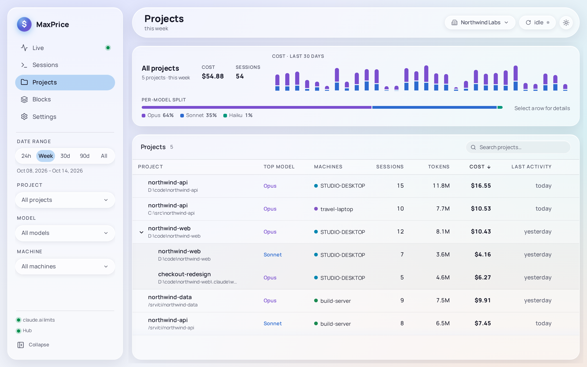

# Projects

Projects shows what each piece of work cost in the Date range: one row per [Project](../concepts/projects.md), with a repository's [Worktrees](../concepts/projects.md#worktrees) and its [checkouts on other machines](../concepts/projects.md#repo-identity) folded into it.

## The table

| Column            | Shows                                                                                                                     |
| ----------------- | ------------------------------------------------------------------------------------------------------------------------- |
| **Project**       | Its name, and its directory under it                                                                                      |
| **Top model**     | The model family it spent most on                                                                                         |
| **Machines**      | The machines it ran on. Only with a [Hub](../concepts/hubs.md) and its [Fleet replica](../concepts/hubs.md#fleet-replica) |
| **Organizations** | Its [Organizations](../concepts/organizations.md). Only while the scope is **All organizations**                          |
| **Sessions**      | Its sessions                                                                                                              |
| **Tokens**        | Its tokens                                                                                                                |
| **Cost**          | Its cost                                                                                                                  |
| **Last activity** | The day of its last request                                                                                               |

A wide window adds **Cost share**, a bar of each project's part of the total. Every figure answers the Date range ([why](../concepts/projects.md#projects-and-the-date-range)).

The table starts with the most expensive project. Click a column's header to sort by it, and again to reverse. The search box finds a project by its name or directory, a worktree's included.

A project with no activity for 90 days or more is dimmed: it is [stale](../concepts/projects.md#stale-projects).

## Folded rows

A row that folds more than one directory has a chevron before its name. Click it to expand the row into one row per directory: first each checkout's own directory, then its worktrees. Click it again to fold them back. Searching for a worktree shows its project already expanded, with only the matching rows.

Select a directory's row for that directory's own figures; select the project's row for the whole project's.

## The totals

With no row selected, the Detail strip above the table sums every project the table shows, with **Cost · last 30 days**, a chart of the last 30 days by model, and **Per-model split**, which divides the cost between model families.

Click a row for that project's figures: its **cost**, **sessions**, when it was **first seen** (the day of its first usage ever, whatever the Date range) and **last seen**, and the same chart and split. Click the row again, press **Esc**, or click outside the table to go back to the totals.

The 30-day chart always covers the last 30 days, whatever the Date range, and ignores the Machine filter.

## Open a project in Live

**Open in Live →** in a selected project's Detail strip, or the arrow that shows when you hover its name, sets the Project filter to that project and opens [Live](live.md). A worktree's row opens its whole project.

## Merging projects

When two rows are the same work but don't fold by themselves, merge them:

1. On the row to fold away, choose the **…** button at its end, **Merge project history**.
2. Under **Merge into**, pick the project to keep. MaxPrice marks the likely ones **Suggested**: those whose directories share its name.
3. Choose **Merge projects**, then **Click again to merge**.

The kept project's row then folds both, and the merged directory carries a **Manual merge** pill when you expand it. **Manage merges**, above the table once any merge exists, lists every merge; choose **Unmerge**, then **Click again to unmerge**, to undo one. A merge changes no files or session logs, and with a Hub it applies on every machine. See [Merging projects](../concepts/projects.md#merging-projects).
