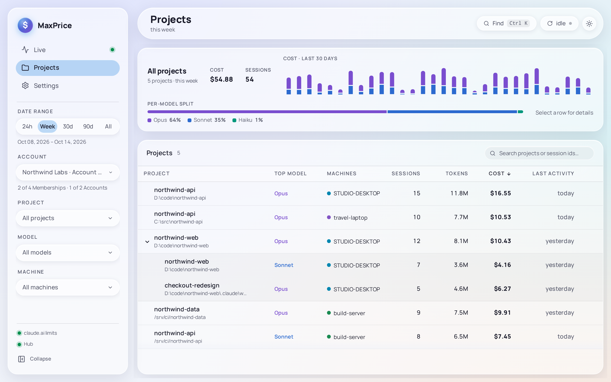
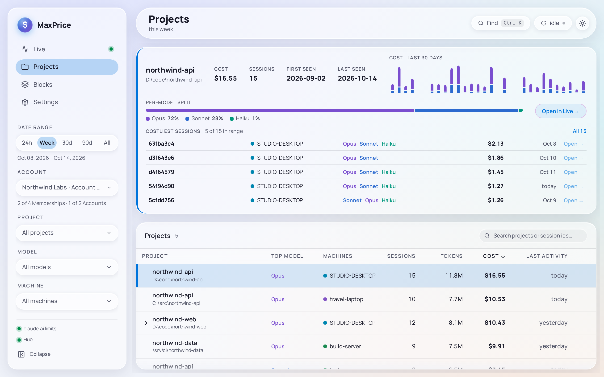
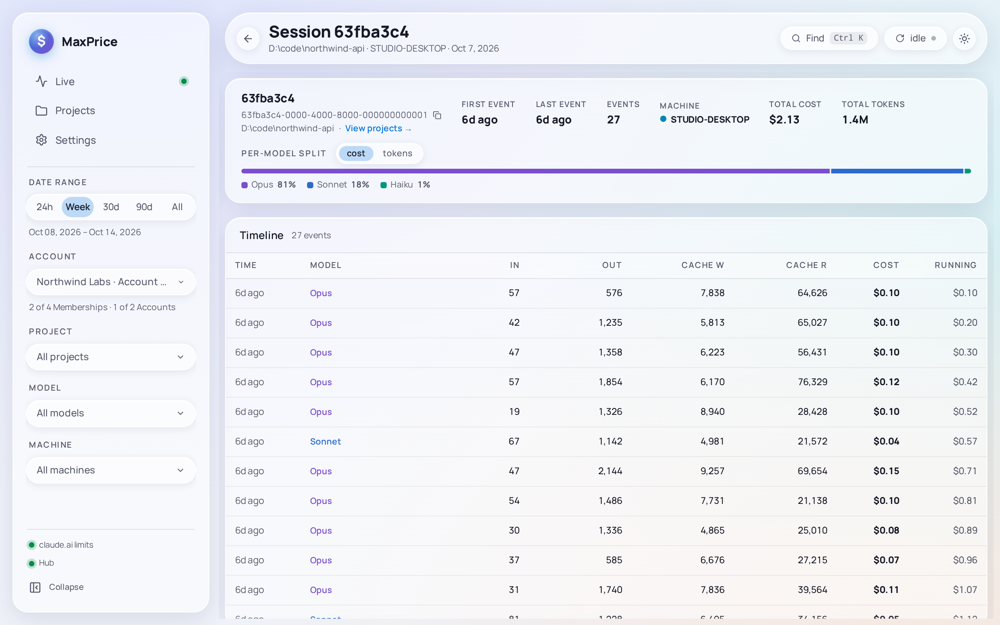

# Projects

Projects shows what each piece of work cost in the Date range: one row per [Project](../concepts/projects.md), with a repository's [Worktrees](../concepts/projects.md#worktrees) and its [checkouts on other machines](../concepts/projects.md#repo-identity) folded into it.

## The table

| Column            | Shows                                                                                                                     |
| ----------------- | ------------------------------------------------------------------------------------------------------------------------- |
| **Project**       | Its name, and its directory under it                                                                                      |
| **Top model**     | The model family it spent most on                                                                                         |
| **Machines**      | The machines it ran on. Only with a [Hub](../concepts/hubs.md) and its [Fleet replica](../concepts/hubs.md#fleet-replica) |
| **Organizations** | Its [Organizations](../concepts/organizations.md). While the Scope spans two or more Organizations                        |
| **Sessions**      | Its sessions                                                                                                              |
| **Tokens**        | Its tokens                                                                                                                |
| **Cost**          | Its cost                                                                                                                  |
| **Last activity** | The day of its last request                                                                                               |

A wide window adds **Cost share**, a bar of each project's part of the total. Every figure answers the Date range ([why](../concepts/projects.md#projects-and-the-date-range)).

The table starts with the most expensive project. Click a column's header to sort by it, and again to reverse. The search box finds a project by its name or directory, a worktree's included, or by a session id: see [Find a session](#find-a-session).

A project with no activity for 90 days or more is dimmed: it is [stale](../concepts/projects.md#stale-projects).

## Folded rows

A row that folds more than one directory has a chevron before its name. Click it to expand the row into one row per directory: first each checkout's own directory, then its worktrees. Click it again to fold them back. Searching for a worktree shows its project already expanded, with only the matching rows.

Select a directory's row for that directory's own figures; select the project's row for the whole project's.

## The totals

With no row selected, the Detail strip above the table sums every project the table shows, with **Cost · last 30 days**, a chart of the last 30 days by model, and **Per-model split**, which divides the cost between model families.

Click a row for that project's figures: its **cost**, **sessions**, when it was **first seen** (the day of its first usage ever, whatever the Date range) and **last seen**, and the same chart and split. Click the row again, press **Esc**, or click outside the table to go back to the totals.

The 30-day chart always covers the last 30 days, whatever the Date range, and ignores the Machine filter.

## A project's sessions

A selected project's Detail strip ends with its sessions, each a Claude Code session log with its own id. It starts with **Costliest sessions**, the five that cost the most. When the project has more, **All N** lists every one under **Every session in range**, in a list that scrolls, and **Top 5** goes back to the five. The count beside the heading, as **5 of 15 in range**, says how many are shown.

Each row shows:

- the first eight characters of the session's id. While two or more [Organizations](../concepts/organizations.md) are tracked, an [owner-less](../concepts/organizations.md#owner-less-usage) session carries a **presumed** or **assigned** pill after it ([Unattributed usage](settings.md#unattributed-usage));
- the machine it ran on, only with a [Hub](../concepts/hubs.md) and its [Fleet replica](../concepts/hubs.md#fleet-replica);
- each model family it used;
- its cost;
- the day of its last request.

Click a row, or its **Open →**, for the session's [detail](#session-detail).

A session counts in the Date range when its last request falls inside it, and then its whole cost shows, from its first request on. A session that ran across several days shows its last day, and everything it cost since it began. So the sessions don't add up to the project's cost, which counts only what was spent inside the Date range.

## Find a session

The table's search also finds a session by its id: type the id, or its first few characters, and the table keeps the projects with a session in the Date range whose id contains them. Select one, and its sessions list shows **Sessions matching** the text, with only those sessions.

To find a session in the Date range whatever the other filters, use [Find](overview.md#find).

## Session detail

A session's detail is a timeline of its requests. It opens from a [project's sessions](#a-projects-sessions) and from [Find](overview.md#find).

The topbar names the session, as **Session 63fba3c4**, with its directory, its machine and its day. The arrow beside it goes back to where you opened it from, as Projects with the project still selected.

The summary shows when the session's first and last requests ran (hover for the exact time), how many requests it made, the machines it ran on, and its **total cost** and **total tokens**. The copy button beside the id copies the whole session id, and **View projects →** opens Projects. **Per-model split** divides the session by model, by **cost** or by **tokens**.

**Timeline** lists every request in the order Claude Code made them:

| Column         | Shows                                                                       |
| -------------- | --------------------------------------------------------------------------- |
| **Time**       | How long ago it ran. Hover for the exact time                               |
| **Model**      | Its model family. Hover for the exact model                                 |
| **In**         | Input tokens sent afresh                                                    |
| **Out**        | Output tokens                                                               |
| **Cache w**    | Tokens written to the prompt cache                                          |
| **Cache r**    | Tokens read from the prompt cache                                           |
| **Cost share** | In a wide window, its cost as a bar against the session's costliest request |
| **Cost**       | Its cost                                                                    |
| **Running**    | The session's cost up to and including it                                   |

A long session loads in pieces, with **streaming** and a count until every request has arrived.

In the **display** cost mode, when every request reads **$0.00**, the session's logs stored no cost, and a note over the Timeline says so. Set [Settings › Cost mode](settings.md#cost-mode) to **calculate**, which the note links, to price its tokens ([Cost modes](../concepts/cost-modes.md#cost-modes)).

The Date range and the Project filter don't narrow a session's detail: it always shows the whole session. The Model and Machine filters and the Scope do, so a session with none of the filtered models reads **No events match the current filters** until you clear them. A session opened from [Find](overview.md#find) ignores them, and the Scope, and shows the whole session. See [Which filter applies where](filters.md#which-filter-applies-where).

## Open a project in Live

**Open in Live →** in a selected project's Detail strip, or the arrow that shows when you hover its name, sets the Project filter to that project and opens [Live](live.md). A worktree's row opens its whole project.

## Merging projects

When two rows are the same work but don't fold by themselves, merge them:

1. On the row to fold away, choose the **…** button at its end, **Merge project history**.
2. Under **Merge into**, pick the project to keep. MaxPrice marks the likely ones **Suggested**: those whose directories share its name.
3. Choose **Merge projects**, then **Click again to merge**.

The kept project's row then folds both, and the merged directory carries a **Manual merge** pill when you expand it. **Manage merges**, above the table once any merge exists, lists every merge; choose **Unmerge**, then **Click again to unmerge**, to undo one. A merge changes no files or session logs, and with a Hub it applies on every machine. See [Merging projects](../concepts/projects.md#merging-projects).
