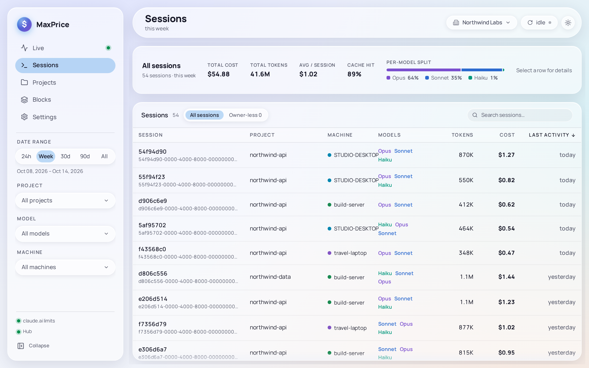
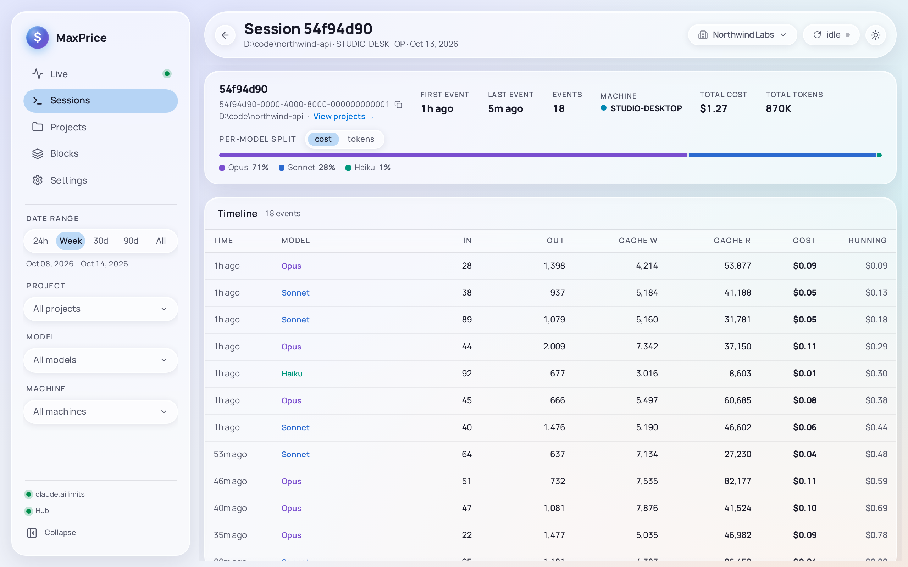

# Sessions

Sessions lists every Claude Code session with usage in the Date range, one row each, and opens any one of them as a timeline of its requests. Each session is one of Claude Code's session logs, with its own id.

## The table

| Column            | Shows                                                                                                                                         |
| ----------------- | --------------------------------------------------------------------------------------------------------------------------------------------- |
| **Session**       | The first eight characters of the session's id, in bold, and the whole id under them                                                          |
| **Project**       | The [Project](../concepts/projects.md) it ran in. A session in a [Worktree](../concepts/projects.md#worktrees) shows its repository's project |
| **Machine**       | The machine it ran on. Only with a [Hub](../concepts/hubs.md) and its [Fleet replica](../concepts/hubs.md#fleet-replica)                      |
| **Organization**  | Its [Organization](../concepts/organizations.md). Only while the scope is **All organizations**                                               |
| **Models**        | Each model family it used                                                                                                                     |
| **Tokens**        | Its tokens                                                                                                                                    |
| **Cost**          | Its cost                                                                                                                                      |
| **Last activity** | The day of its last request                                                                                                                   |

A wide window adds **Cost share**, a bar of each session's part of the total.

The table starts newest first. Click a column's header to sort by it, and again to reverse. The search box above the table finds a session by its id, its project's name or directory, a model, and its machine or Organization when those columns show.

A session counts in the Date range when its last request falls inside it, and then its whole usage counts, from its first request on. A session that ran across several days shows its last day, and everything it cost since it began.

## The totals

With no row selected, the Detail strip above the table sums every session the table shows: **total cost**, **total tokens**, **avg / session** and **cache hit**, the share of input tokens read from Claude's prompt cache rather than sent afresh. **Per-model split** divides the cost between model families.

Click a row to see the same figures for that session alone, with its project's directory. Click it again, press **Esc**, or click anywhere outside the table to go back to the totals.

## Session detail

To open a session, select its row, then choose **View full timeline →**.

The topbar names the session, as **Session 54f94d90**, with its directory, its machine and its day. The arrow beside it goes back to Sessions, with the row still selected.

The summary shows when the session's first and last requests ran (hover for the exact time), how many requests it made, the machines it ran on, and its **total cost** and **total tokens**. The copy button beside the id copies the whole session id. **Per-model split** divides the session by model, by **cost** or by **tokens**.

**Timeline** lists every request in the order Claude Code made them:

| Column      | Shows                                         |
| ----------- | --------------------------------------------- |
| **Time**    | How long ago it ran. Hover for the exact time |
| **Model**   | Its model family. Hover for the exact model   |
| **In**      | Input tokens sent afresh                      |
| **Out**     | Output tokens                                 |
| **Cache w** | Tokens written to the prompt cache            |
| **Cache r** | Tokens read from the prompt cache             |
| **Cost**    | Its cost                                      |
| **Running** | The session's cost up to and including it     |

A long session loads in pieces, with **streaming** and a count until every request has arrived.

The Date range and the Project filter don't narrow a session's detail: it always shows the whole session. The Model and Machine filters do, so a session with none of the filtered models reads **No events match the current filters** until you clear them. See [Which filter applies where](filters.md#which-filter-applies-where).

## Owner-less sessions

While two or more [Organizations](../concepts/organizations.md) are tracked, a session whose log records no Organization is [owner-less](../concepts/organizations.md#owner-less-usage), and carries a pill after its id:

- **presumed**: counted under its [Presumed organization](../concepts/organizations.md#presumed-organization);
- **assigned**: counted under the Organization you assigned it to.

A session that recorded its Organization part-way through shows **· part** after the pill: only its owner-less part moves.

### Assigning sessions to an Organization

The **Owner-less** tab beside **All sessions** lists only owner-less sessions, grouped by project. Its count is how many the filters leave. **Review** in [Settings › Claude account](settings.md#claude-account) opens it over all time.

1. Tick the sessions to move, or a project's box for all of its sessions. **Select all N shown** ticks every session the list shows.
2. Choose **Assign to…** and pick the Organization to count them under. MaxPrice counts them there at once, and offers **Undo**.
3. To count them by presumption again, tick them and choose **Clear assignment**.

**Done** or **Esc** clears the ticks. An assignment covers the sessions you ticked, not later ones, and with a Hub it applies on every machine. Assigning sessions to an [Excluded organization](../concepts/organizations.md#tracked-and-excluded-organizations) asks first, because that usage then leaves every report on this machine; [Organizations](../concepts/organizations.md#assigning-owner-less-sessions) says how to bring it back.
