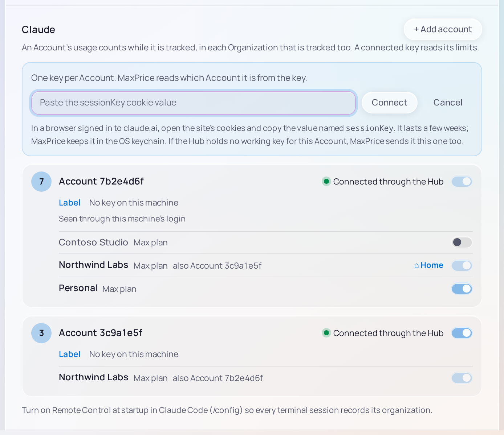
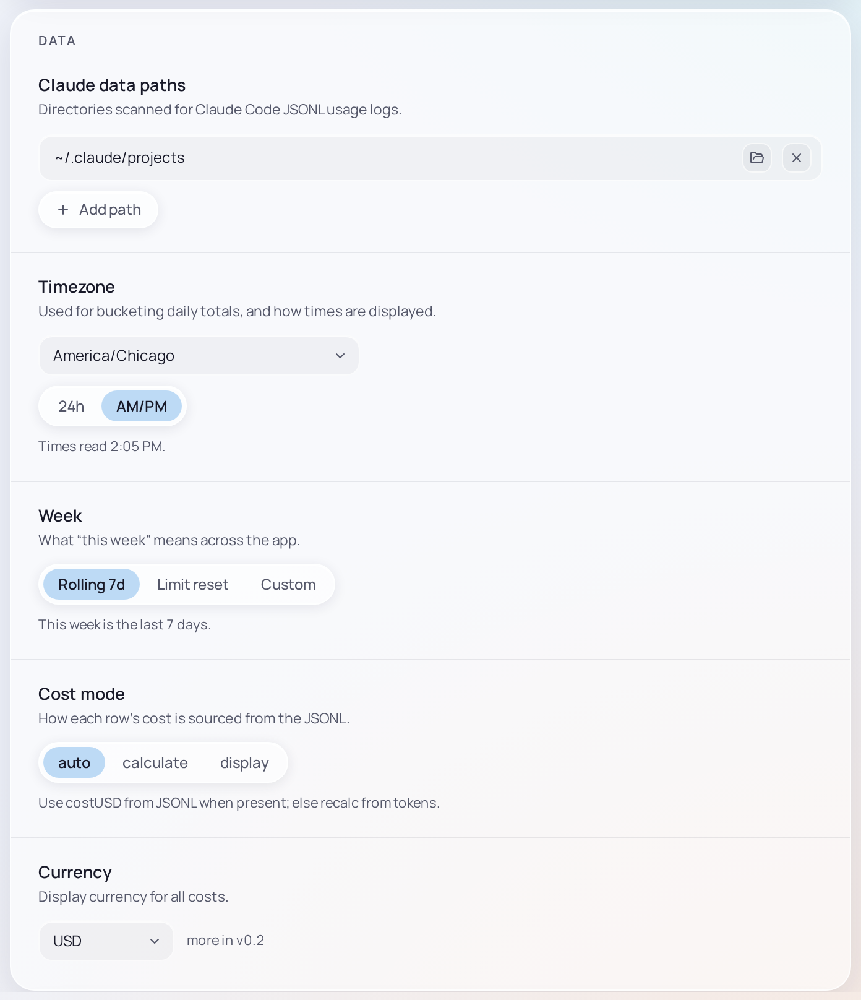
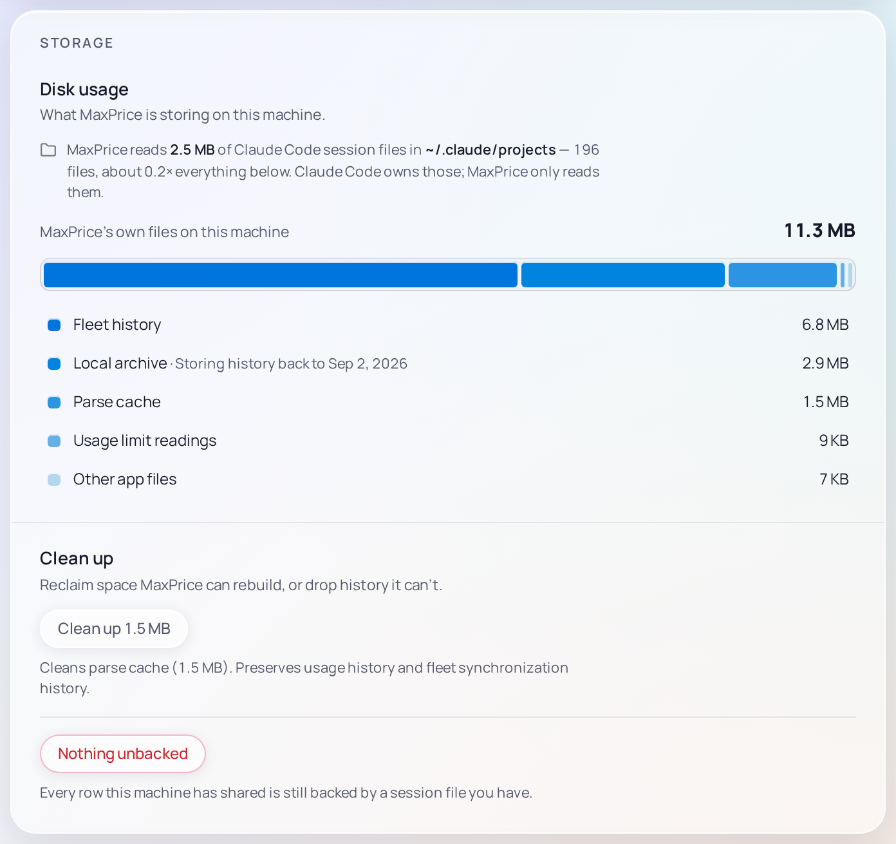
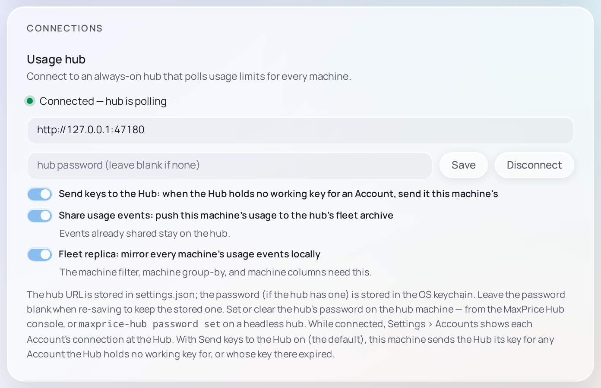
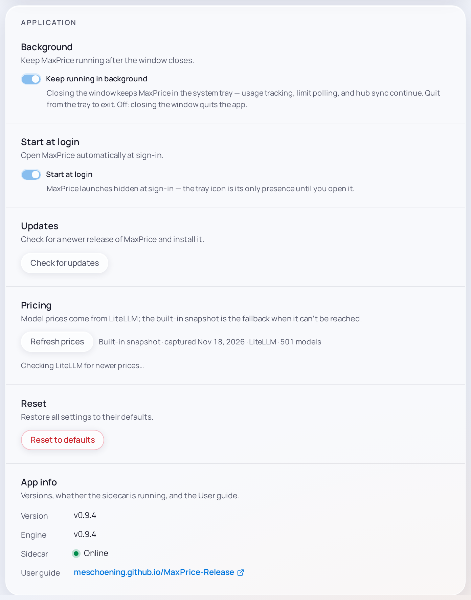

# Settings

Settings is the last page in the sidebar. It holds five groups, **Account** (**Accounts** once there are two or more), **Data**, **Storage**, **Connections** and **Application**, one after another on one page. A change takes effect as you make it: there is no Save button, except for session keys, Gateways and the Hub, which you connect.

The settings are kept in `settings.json` in the Desktop client's folder ([where](../concepts/archive.md#desktop-client)). The claude.ai session keys, Gateway management keys and the [Hub](../concepts/hubs.md) password are kept in the system's keychain instead.

## Accounts

The first group lists every claude.ai [Account](../concepts/organizations.md#accounts) this machine knows, each with its [Organizations](../concepts/organizations.md), and what reads their limits. Its heading reads **Account** while there is one and **Accounts** once there are more. From top to bottom it holds the notices that need you, the Home membership, a section per provider (only **Claude** today), **Gateways** and **Unattributed usage**.

### Notices

A notice shows at the top only while it applies:

- **Your saved session key has expired.** A key saved before this version, which MaxPrice could not yet file under its Account, stopped working. **Reconnect** opens the paste step under the notice: paste a fresh key, and MaxPrice files it under the Account it belongs to.
- **N Accounts need reconnecting**, naming each one. Their limits show the last reading until you reconnect. Click a name to open that Account's Connect.
- **Limits come from the Hub**, while this machine is connected to its [Hub](join-a-hub.md), with the **Send keys to the Hub** switch ([Send keys to the Hub](../concepts/hubs.md#send-keys-to-the-hub)). Keys you connect here also stay on this machine, for when the Hub can't read.

### Home membership

With two or more Accounts, a menu chooses this machine's [Home membership](../concepts/organizations.md#home-membership): one Organization reached through one Account, listed as **Organization · Account (plan)**. It is the default [Scope](filters.md#the-scope), and where usage with no attribution evidence counts. It lists the Memberships of tracked Accounts, so track an Account first to make one of its Organizations Home. Choosing one also tracks its Organization, and while it is Home neither its Account's switch nor its Organization's can be turned off. With one Account there is nothing to choose, and the menu doesn't show.

### Claude

One card per tracked Account, the most used first: the Account with the highest limit reading leads, and one whose limits can't be read comes last. An Account's usage counts while it is tracked, in each Organization that is tracked too.

**The card.** Its title is the Account's label, with its email under it; with no label the email is the title. A [Pending account](../concepts/organizations.md#accounts), known only by an email in your logs, is titled **Pending account** and the first 8 characters of its id, over a dashed **@** and **Known by email only**; once you connect it, its email takes that title's place. On the right sit its key's state, **Connect** or **Reconnect** when it needs a key, and its switch:

| State                     | Means                                                 |
| ------------------------- | ----------------------------------------------------- |
| **Connected**             | Its session key works and reads its limits.           |
| **Key expired**           | claude.ai refused its key. Choose **Reconnect**.      |
| **No key**                | This machine holds no key for it. Choose **Connect**. |
| **Can't reach claude.ai** | MaxPrice couldn't ask claude.ai. It tries again.      |

On a machine joined to a Hub the states are the Hub's: **Connected through the Hub**, **Key expired at the Hub** or **No key at the Hub**, and the card adds whether this machine also holds a key.

Under the head:

- **Label** (or **Rename** once it has one) edits the Account's label in place; save it empty to go back to the email ([labels](../concepts/organizations.md#accounts)).
- **Disconnect** removes this machine's key for the Account at once. Its tracking, label and history stay. On a machine joined to a Hub that holds a key for it too, the card says so: remove that one at the Hub.
- **key set** and a date, when the key was saved.
- **Seen through** says where this machine sees the Account: its own login, a [Gateway](#gateways), or both.

**Its Organizations** sit inside the card, one row each: the label (click it to rename the Organization, [labels](../concepts/organizations.md#organization-labels)), its plan, a **New** tag for one first seen since you last opened Settings, and **also** with the other Accounts that reach it. While sessions are [assigned](#unattributed-usage) to the Organization, the row adds **N sessions assigned · Unassign**: **Unassign** clears every one of those assignments, with a Hub on every machine, so each session counts under its Presumed membership again and returns to Unattributed usage. MaxPrice offers **Undo**. On the right:

- **Limits not readable** when this key can't read that Organization's limits; MaxPrice asks again every hour, and its usage still counts while it is tracked.
- **Last reading 71% · 2 days ago · Reconnect** while the Account's key is expired, or **Not read since the key expired** when there is no reading to show.
- **⌂ Home** on the Home membership.
- The Organization's switch. An Organization's tracking is shared by every Account that reaches it.

**Tracking.** The Account's switch tracks it at once, or excludes it once you type its label: its usage then leaves every report on this machine, and with a Hub this machine's sessions for it leave the Hub ([tracked and excluded](../concepts/organizations.md#tracked-and-excluded-organizations)). An Organization's switch tracks it once you confirm **Track**, or excludes it once you type its label.

**Not tracked.** Accounts this machine doesn't count, Pending ones included, sit under **Not tracked · N** below the cards: seen in your logs, with nothing of theirs counted. The group folds once it holds more than two, and shows **New** while it holds an Account with a new Organization. Each row shows its key's state, **Connect** or **Reconnect** when it needs a key, its switch, and **Label** (or **Rename**).

**Many Accounts.** Past six, each card folds to one line, its email and its Organizations, and a chevron opens it. A card that needs a key, holds a new Organization or holds Home stays open. A filter, **Filter N accounts or their Organizations**, matches labels, emails and Organization labels.

Under the cards, **Show model limit in tray popout** shows only when your plan has a model-scoped weekly limit. On, it adds that limit's row to the [Popout](tray.md) under the weekly limit. While Claude Code's **Remote Control at startup** is off, a line under them asks you to turn it on, so every terminal session records its Organization ([why](../concepts/organizations.md#owner-less-usage)).

### Connecting an Account

Each claude.ai Account has its own [session key](../concepts/blocks.md#the-claudeai-session-key). Choose **+ Add account** beside **Claude** for a new one, **Connect** or **Reconnect** on a card, or a stale reading's **Reconnect**. The Connect step opens in place:

1. Paste the value of your browser's `sessionKey` cookie and choose **Connect**. MaxPrice checks it with claude.ai and learns which Account it belongs to from the key. On a machine joined to a Hub, the line under the field says whether the key also goes to the Hub.
2. The result names the Account, as **● Connected Work**, and says what happened: the earlier key was replaced, connecting tracked the Account, or the key also went to the Hub.
3. **Its N Organizations** lists the key's Organizations, each with its switch. A new Organization starts not tracked: its usage counts only once you turn it on. Choose **Done**.

A key for another Account than the card you started from still connects: MaxPrice connects and tracks that Account and says **This key is for another Account**, naming it, while the one you started from stays as it was. claude.ai refusing the key, or a Claude Code token pasted by mistake, shows why under the field.

Live's **Reconnect** links open this group with that Account's Connect already open. **⚠ Session expired — reconnect →** on its tiles does too when one Account's key expired; otherwise it opens the group, whose notice names each.

### Gateways

A Gateway, such as CLIProxyAPI, serves Claude Code on accounts it holds itself and records which one served each request. It is one way to use an Account, as logging in directly is: neither comes first. Connected, its records tell MaxPrice which Account and Organization a session used when the session's own log doesn't say.

Each Gateway has a row: its address, its state (**Draining** while it works, else **Statistics off**, **Unreachable**, **Key refused** or **Error**), when its last record came, **Drained by the Hub** while your Hub reads it, the Accounts it holds, and **Remove**.

To connect one, choose **Connect a Gateway**, type its address and its management key, and choose **Connect**. MaxPrice checks that the Gateway answers, that the key works and that it answers as CLIProxyAPI's management API does, and stores nothing when a check fails. Once it passes, it reads **Connected** with the Gateway's host and shows two warnings:

- Set the Gateway's usage queue retention to 3600 seconds or more, so its records wait between MaxPrice's reads.
- MaxPrice must be the only consumer of that queue: anything else that drains it takes records MaxPrice then never sees.

Connecting tracks nothing: an Account first seen through a Gateway starts not tracked. With none connected, the subsection reads **No Gateway is connected on this machine.** On a machine joined to a Hub, the Gateway is also sent to the Hub once, and the Hub reads it from then on; **Remove** here leaves the Hub's copy, which you remove at the Hub.

### Unattributed usage

While there are any, the group ends with the sessions of the last 30 days whose logs give no evidence of their Account or Organization and that nobody has assigned. Each counts under its [Presumed membership](../concepts/organizations.md#owner-less-usage), the Home membership of the machine it ran on, until you assign it, and counts under no Account until then, even with one Account tracked. The heading's pill counts them and their cost.

They are grouped by project; open a project to see its sessions, or search them. When they look like they ran through a Gateway, a note offers **Connect a Gateway**.

1. Select sessions, or tick a project for all of its sessions.
2. Choose **Assign to…** and pick the Membership, **Organization · Account**, to count them under. MaxPrice counts them there at once and offers **Undo**.

An assignment covers the sessions you selected, not later ones, and with a Hub it applies on every machine. An assigned session leaves the list; its Organization's row on the card counts it, and **Unassign** there brings it back. Assigning sessions to an [Excluded organization](../concepts/organizations.md#tracked-and-excluded-organizations) asks first, because that usage then leaves every report on this machine; [Organizations](../concepts/organizations.md#assigning-owner-less-sessions) says how to bring it back.

## Data

### Claude data paths

The folders MaxPrice reads Claude Code's session logs from: `~/.config/claude/projects` and `~/.claude/projects` by default. **Add path** picks another folder, such as one on another drive. Each path's folder button opens it in Finder, Explorer or your file manager, and its **×** removes it at once.

If you set `CLAUDE_CONFIG_DIR` to move Claude Code's data, MaxPrice still reads the folders in this list, not the variable's: it falls back to the variable's `projects` folder only when none of the listed folders exists. When MaxPrice can see the variable and its `projects` folder exists but isn't listed, a note under the list names the folder, and its **Add** button adds it as a path. MaxPrice sees the variable only if it is set where the app starts, such as your user environment on Windows; one set in a terminal reaches MaxPrice only when you start MaxPrice from that terminal. Otherwise, add the folder with **Add path**.

### Timezone

The timezone MaxPrice counts days in and shows times in: where today starts, which day a request falls on, and every clock time on screen. It starts as your system's. **24h** and **AM/PM** choose how times read, as **14:05** or **2:05 PM**.

### Week

What **this week** means, for Live's [This week](live.md#this-week) tile, the **Week** Date range and the chart's **Week** span:

- **Rolling 7d**, the default: today and the 6 days before.
- **Limit reset**: since your [weekly limit](../concepts/blocks.md#usage-limits) last reset, as claude.ai reports it. Until there is a reading, it falls back to the last 7 days.
- **Custom**: since a weekday and time you choose, under **Week starts on** and **Week starts at**.

The line under it says when this week started.

### Cost mode

Where each request's cost comes from: **auto**, the default, **calculate** or **display**. [Cost modes](../concepts/cost-modes.md#cost-modes) explains each. The mode applies to every report, and shows only here.

### Currency

Costs are in US dollars. There is no other currency yet.

## Storage

### Disk usage

How much Claude Code's session logs take, which MaxPrice reads but never changes, and how much MaxPrice's own files take, as a bar split by kind. Hover a legend entry for what it holds. [Storage in Settings](../concepts/archive.md#storage-in-settings) lists every kind.

### Clean up

**Clean up** frees the space MaxPrice can rebuild, and says how much before you choose it. With a Hub and its [Fleet replica](../concepts/hubs.md#fleet-replica), **Forget N rows…** deletes the usage this machine shared whose session logs are gone, from the Hub too, once you type this machine's name. [Storage in Settings](../concepts/archive.md#storage-in-settings) says what each keeps.

## Connections

### Usage hub

Joins this machine to a Hub. Type the Hub's address, as `http://my-desktop.tailnet.ts.net:47100`, and its password if it has one, and choose **Connect**. MaxPrice adds `http://` and port 47100 when you leave them out. [Join a Hub](join-a-hub.md) walks through it.

The status line says how the Hub is doing: **Connected — hub is polling** while it works, or why this machine is [polling locally](../concepts/hubs.md#fallback-polling). While you are connected, [Accounts](#accounts) shows each Account's key as the Hub holds it. An amber warning shows under an address that isn't on a [tailnet](../concepts/hubs.md#tailnet) or this machine.

Once you are connected, the button reads **Save**: to change the password, type the new one and save; leave the field blank to keep the stored one. **Disconnect** leaves the Hub at once, and this machine reads its limits with its own session key again.

Its three switches are each on by default:

- **Send keys to the Hub** sends this machine's session keys to the Hub, each one when the Hub holds no working key for its Account ([Send keys to the Hub](../concepts/hubs.md#send-keys-to-the-hub)). It is the same switch as the one in the [Accounts](#notices) notice.
- **Share usage events** sends this machine's usage to the Hub ([Share usage events](../concepts/hubs.md#share-usage-events)).
- **Fleet replica** keeps a copy of every machine's usage here, for the Machine filter and the machine columns. Turning it off deletes the copy ([Fleet replica](../concepts/hubs.md#fleet-replica)).

## Application

### Background

macOS and Windows. **Keep running in background**, on by default, keeps MaxPrice running when you close its window, with its icon in the system tray, so it goes on reading your usage, your limits and your Hub. Quit it from the tray. Off, closing the window quits MaxPrice. See [Tray and Popout](tray.md).

### Start at login

macOS and Windows. **Start at login** opens MaxPrice when you sign in to your computer, hidden in the tray until you open it. On Windows, if you turned it off in Task Manager's **Startup** tab, turning it on here turns it back on there too.

### Updates

**Check for updates** looks for a newer release. When there is one, **Update to …** downloads and installs it, and MaxPrice reopens on its own. On Linux there are no updates here: install the newest `.deb` from the releases page. See [Update](update.md).

### Pricing

**Refresh prices** fetches the newest model prices from LiteLLM now. The line beside it says which prices are in use, as **Live · fetched 2h ago · LiteLLM · 419 models** or **Built-in snapshot · captured Oct 18, 2026 · LiteLLM · 419 models**, and the line under it names any [unpriced model](../concepts/cost-modes.md#unpriced-models). [Where prices come from](../concepts/cost-modes.md#where-prices-come-from) says when MaxPrice fetches them by itself.

### Reduce transparency

macOS only. **Opaque surfaces** draws MaxPrice's panels solid rather than as frosted glass, since macOS doesn't pass its own **Reduce transparency** setting on to the app.

### Reset

**Reset to defaults**, then **Reset**, returns every setting kept in `settings.json` to its default, though its prompt names only three of them. That includes:

- the Hub: MaxPrice leaves it, and forgets its address and password;
- your Home and Tracked organizations, and the [Scope](filters.md#the-scope), which returns to the Home membership. At its next start MaxPrice picks a Home again, as at its first launch, and tracks only that one.
- which [Accounts](../concepts/organizations.md#accounts) it counts. At its next start it counts only the new Home's Account, as at its first launch: the Account of the one kept session key that reads Home's Organization, else the one that owns most of its sessions.

It keeps the claude.ai session keys, Gateways, Start at login and Opaque surfaces.

> [!WARNING]
> Reset forgets which Organizations and Accounts this machine tracks. Track them again afterwards in [Accounts](#accounts): an Account's switch, or connecting its session key, tracks it again.

### App info

- **Version**: the Desktop client's version.
- **Engine**: the version of the engine that reads your logs and computes every figure, which matches **Version**.
- **Sidecar**: whether the engine is running: **Online**, **Reconnecting…** or **Offline**.
- **User guide**: opens this guide's [Desktop client Overview](overview.md) in your browser.
