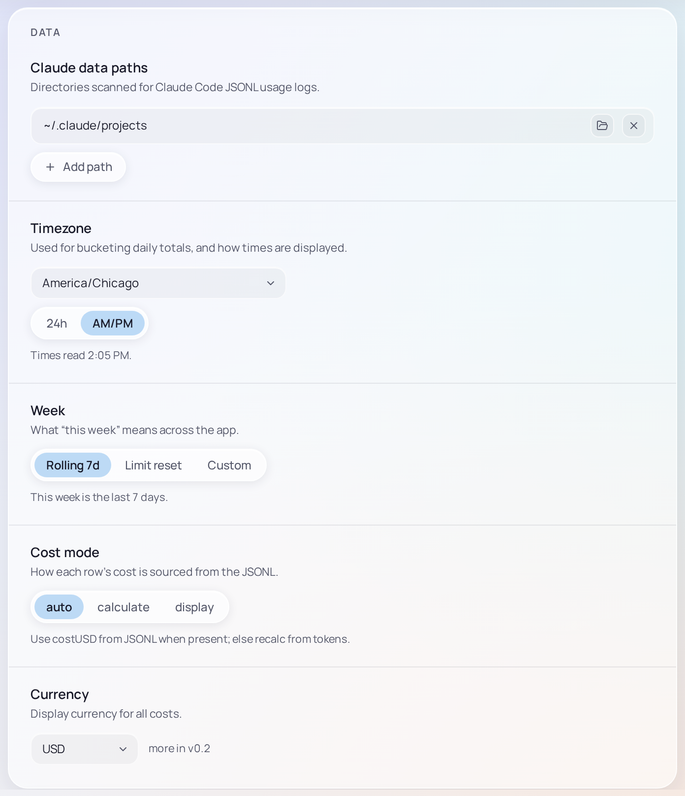
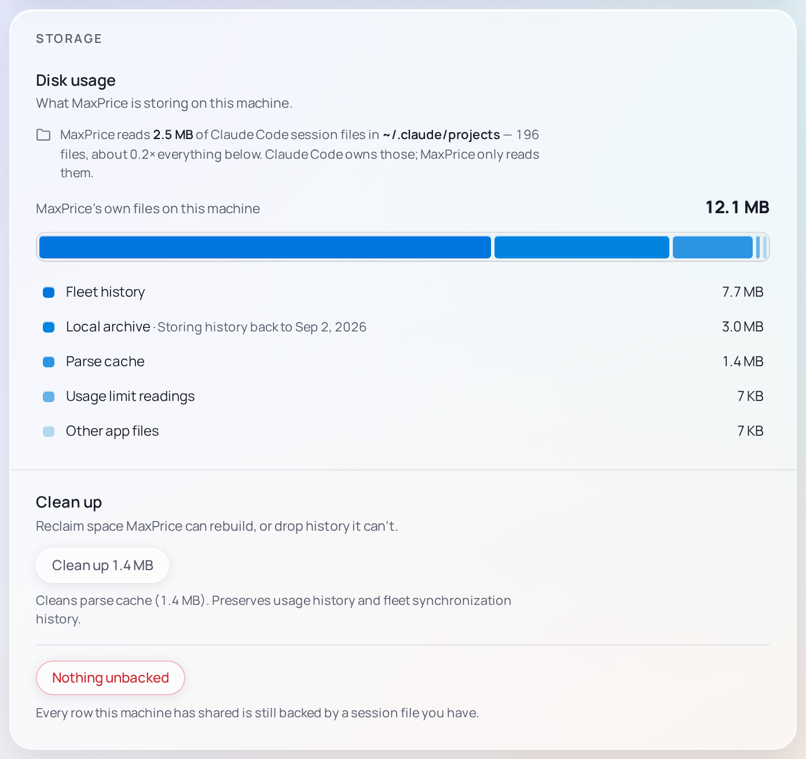
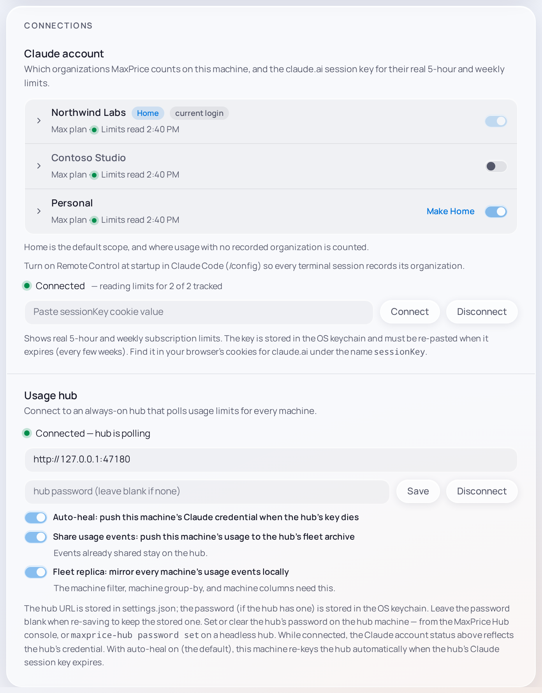
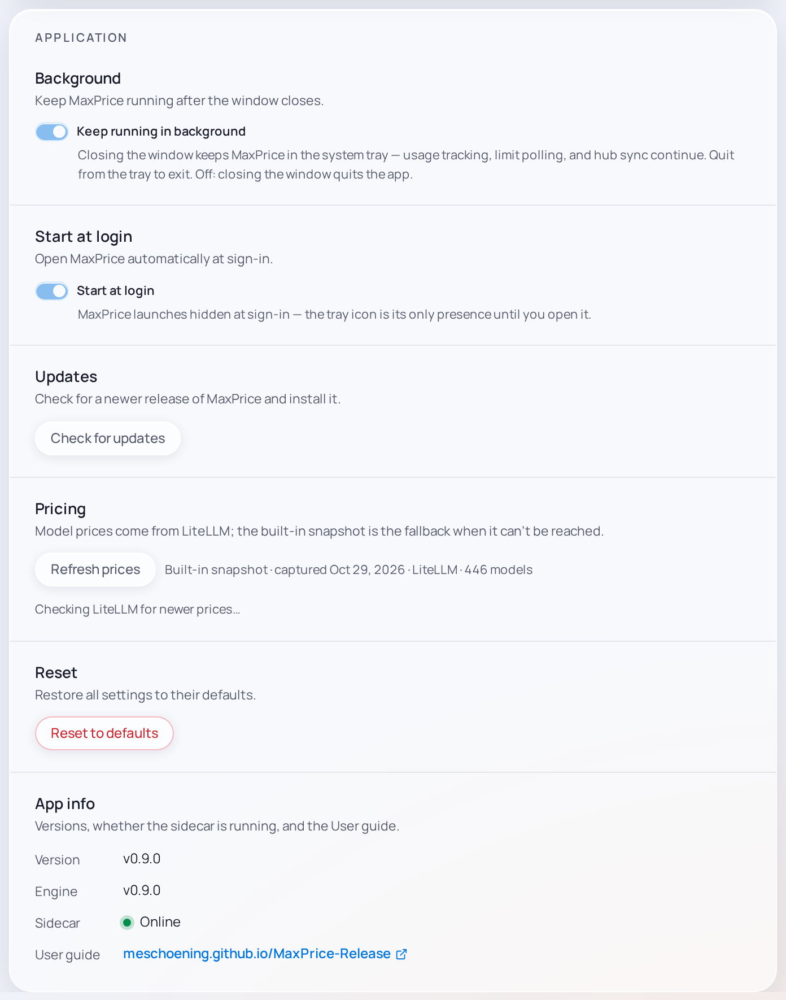

# Settings

Settings is the last page in the sidebar. It holds four groups, **Data**, **Storage**, **Connections** and **Application**, one after another on one page. A change takes effect as you make it: there is no Save button, except for the session key and the Hub, which you connect.

The settings are kept in `settings.json` in the Desktop client's folder ([where](../concepts/archive.md#desktop-client)). The claude.ai session key and the [Hub](../concepts/hubs.md) password are kept in the system's keychain instead.

## Data

### Claude data paths

The folders MaxPrice reads Claude Code's session logs from: `~/.config/claude/projects` and `~/.claude/projects` by default. **Add path** picks another folder, such as one on another drive. Each path's folder button opens it in Finder, Explorer or your file manager, and its **×** removes it at once.

### Timezone

The timezone MaxPrice counts days in and shows times in: where today starts, which day a request falls on, and every clock time on screen. It starts as your system's. **24h** and **AM/PM** choose how times read, as **14:05** or **2:05 PM**.

### Week

What **this week** means, for Live's [This week](live.md#this-week) tile, the **Week** Date range and the chart's **Week** span:

- **Rolling 7d**, the default: today and the 6 days before.
- **Limit reset**: since your [weekly limit](../concepts/blocks.md#usage-limits) last reset, as claude.ai reports it. Until there is a reading, it falls back to the last 7 days.
- **Custom**: since a weekday and time you choose, under **Week starts on** and **Week starts at**.

The line under it says when this week started.

### Cost mode

Where each request's cost comes from: **auto**, the default, **calculate** or **display**. [Cost modes](../concepts/cost-modes.md#cost-modes) explains each. The mode applies to every report, and shows only here.

### Currency

Costs are in US dollars. There is no other currency yet.

## Storage

### Disk usage

How much Claude Code's session logs take, which MaxPrice reads but never changes, and how much MaxPrice's own files take, as a bar split by kind. Hover a legend entry for what it holds. [Storage in Settings](../concepts/archive.md#storage-in-settings) lists every kind.

### Clean up

**Clean up** frees the space MaxPrice can rebuild, and says how much before you choose it. With a Hub and its [Fleet replica](../concepts/hubs.md#fleet-replica), **Forget N rows…** deletes the usage this machine shared whose session logs are gone, from the Hub too, once you type this machine's name. [Storage in Settings](../concepts/archive.md#storage-in-settings) says what each keeps.

## Connections

### Claude account

Your claude.ai [Organizations](../concepts/organizations.md), and the session key that reads their usage limits.

**Organizations.** With one Organization, a menu shows your [Home organization](../concepts/organizations.md#home-organization). With two or more, each has a row: its label, its plan and whether its limits can be read, and a switch that tracks or excludes it.

- Click a label to rename it ([labels](../concepts/organizations.md#organization-labels)).
- **Make Home** makes a [Tracked organization](../concepts/organizations.md#tracked-and-excluded-organizations) this machine's Home.
- The switch tracks an Organization, once you confirm **Track**, or excludes it, once you type its label ([tracked and excluded](../concepts/organizations.md#tracked-and-excluded-organizations)). Home's switch can't be turned off.
- The chevron shows an Organization's plan, its limits, where it has been seen and its id.
- **Review**, under the list, opens the sessions counted under Home by presumption, in [Sessions](sessions.md#assigning-sessions-to-an-organization).

A new Organization turns up with a **New** tag, excluded until you track it. **current login** marks the one Claude Code is signed in to.

**Session key.** Paste your claude.ai [session key](../concepts/blocks.md#the-claudeai-session-key) and choose **Connect**. MaxPrice checks it with claude.ai, then keeps it in the system's keychain. The status line above the field reads **Connected** while the key works. When it reads **Session expired** (**Session key expired** with two or more Organizations), copy a fresh key and connect again. **Disconnect** removes the key at once.

**Show model limit in tray popout** shows only when your plan has a model-scoped weekly limit. On, it adds that limit's row to the [Popout](tray.md) under the weekly limit.

### Usage hub

Joins this machine to a Hub. Type the Hub's address, as `http://my-desktop.tailnet.ts.net:47100`, and its password if it has one, and choose **Connect**. MaxPrice adds `http://` and port 47100 when you leave them out. [Join a Hub](join-a-hub.md) walks through it.

The status line says how the Hub is doing: **Connected — hub is polling** while it works, or why this machine is [polling locally](../concepts/hubs.md#fallback-polling). While you are connected, Claude account's status is the Hub's key's. An amber warning shows under an address that isn't on a [tailnet](../concepts/hubs.md#tailnet) or this machine.

Once you are connected, the button reads **Save**: to change the password, type the new one and save; leave the field blank to keep the stored one. **Disconnect** leaves the Hub at once, and this machine reads its limits with its own session key again.

Its three switches are each on by default:

- **Auto-heal** sends this machine's session key to the Hub when the Hub's own key stops working ([Auto-heal](../concepts/hubs.md#auto-heal)).
- **Share usage events** sends this machine's usage to the Hub ([Share usage events](../concepts/hubs.md#share-usage-events)).
- **Fleet replica** keeps a copy of every machine's usage here, for the Machine filter and the machine columns. Turning it off deletes the copy ([Fleet replica](../concepts/hubs.md#fleet-replica)).

## Application

### Background

macOS and Windows. **Keep running in background**, on by default, keeps MaxPrice running when you close its window, with its icon in the system tray, so it goes on reading your usage, your limits and your Hub. Quit it from the tray. Off, closing the window quits MaxPrice. See [Tray and Popout](tray.md).

### Start at login

macOS and Windows. **Start at login** opens MaxPrice when you sign in to your computer, hidden in the tray until you open it. On Windows, if you turned it off in Task Manager's **Startup** tab, turning it on here turns it back on there too.

### Updates

**Check for updates** looks for a newer release. When there is one, **Update to …** downloads and installs it, and MaxPrice reopens on its own. On Linux there are no updates here: install the newest `.deb` from the releases page. See [Update](update.md).

### Pricing

**Refresh prices** fetches the newest model prices from LiteLLM now. The line beside it says which prices are in use, as **Live · fetched 2h ago · LiteLLM · 419 models** or **Built-in snapshot · captured Oct 18, 2026 · LiteLLM · 419 models**, and the line under it names any [unpriced model](../concepts/cost-modes.md#unpriced-models). [Where prices come from](../concepts/cost-modes.md#where-prices-come-from) says when MaxPrice fetches them by itself.

### Reduce transparency

macOS only. **Opaque surfaces** draws MaxPrice's panels solid rather than as frosted glass, since macOS doesn't pass its own **Reduce transparency** setting on to the app.

### Reset

**Reset to defaults**, then **Reset**, returns every setting kept in `settings.json` to its default, though its prompt names only three of them. That includes:

- the Hub: MaxPrice leaves it, and forgets its address and password;
- your Home and Tracked organizations, and the [Organization scope](filters.md#the-organization-scope). At its next start MaxPrice picks a Home again, as at its first launch, and tracks only that one.

It keeps the claude.ai session key, Start at login and Opaque surfaces.

> [!WARNING]
> Reset forgets which Organizations this machine tracks. With more than one, track them again afterwards in Claude account.

### App info

- **Version**: the Desktop client's version.
- **Engine**: the version of the engine that reads your logs and computes every figure, which matches **Version**.
- **Sidecar**: whether the engine is running: **Online**, **Reconnecting…** or **Offline**.
- **User guide**: opens this guide's [Desktop client Overview](overview.md) in your browser.
