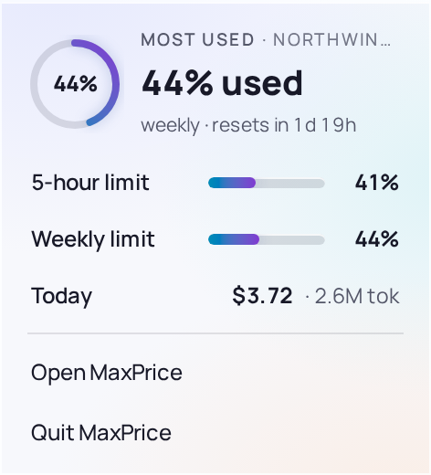

# Tray and Popout

On macOS and Windows, MaxPrice keeps an icon in the menu bar or the notification area. Clicking it opens the Popout, with your limits and today's cost. By default, MaxPrice keeps running after you close its main window, and the tray icon is your way back to it.

> [!IMPORTANT]
> On Linux the Desktop client has no tray icon and no Popout. Closing its window quits it, and it has no **Start at login**.

## The tray icon

- **macOS:** a `$` in the menu bar. Beside it, the menu bar shows how much of your [5-hour limit](../concepts/blocks.md#usage-limits) you have used while a [Block](../concepts/blocks.md#blocks) is active, or else today's cost.
- **Windows:** the MaxPrice icon in the notification area. Hover over it for the same figure, as **MaxPrice — 5-hour limit 41%** or **MaxPrice — today $3.72**. Where you track several Organizations, the limit names the Organization it reads, the Scope's or, under **All organizations**, Home's ([whose limits](../concepts/organizations.md#whose-limits-a-page-shows)). While the [Scope](filters.md#the-scope) holds more than one Membership, today's cost says what it adds up: **MaxPrice — today $3.72 (all accounts)** under All accounts, **(all organizations)** under All organizations, or **(3 memberships)** for any other set. Windows may hide a new icon behind the **^** arrow; drag it onto the taskbar to keep it in view.

The figure updates about once a minute. While a new version is waiting, the icon wears a dot (see [Update](update.md)).

### The figure with several Memberships

With one Account tracked, the figure is as above whatever the Scope holds. With two or more Accounts tracked, once the Scope holds two or more [Memberships](../concepts/organizations.md#memberships), as under **All accounts**, each with its own limits, the figure describes the most used one:

- **Two or more Memberships whose limits MaxPrice can read, and a 5-hour window open in at least one:** the most used Membership's most used limit, whichever window it is. On macOS the menu bar reads **91%**, or **82% wk** when that limit is a weekly one. On Windows the tooltip names it and how many more the Scope holds, as **MaxPrice — Northwin…· Account 7b2e4d6f 5-hour limit 91%** and **+2 more**. Windows shows a tooltip whole only up to 63 characters, so a long name is shortened in the middle, and the percent always shows. When there is room, a **Next:** line names the next most used, as **Next: Personal 82% wk**.
- **No 5-hour window open in any of them:** today's cost, as above. The tooltip adds the most used limit on a second line, as **Most used: Northwi…count 7b2e4d6f 82% wk** below **MaxPrice — today $3.72**, its name shortened to fit. Beside a longer first line, such as **(all accounts)**, only a short name fits, and a long one is left out.
- **Only one Membership whose limits can be read, or none:** the figure as above.

A Membership whose Account's session key has expired keeps its place in the Popout's list, but its last reading never sets the figure.

## The Popout

Click the tray icon, with either mouse button, to open the Popout beside it. Click it again, click anywhere else or press Esc to close it.

From the top:

- **Active block:** a ring counting down to the [Active block](../concepts/blocks.md#active-block)'s reset, with its cost, its tokens and the time it resets. With no Active block it reads **No active block — start a Claude Code session to open one.** It shows the Active block of usage whose Account isn't known, marked **account not known**, when your Home membership's Account has no usage at all.
- **5-hour limit** and **Weekly limit:** how much of each you have used. They read **—** without a [session key](../concepts/blocks.md#the-claudeai-session-key).
- A third limit row, such as **Fable limit**, when your plan limits one model for the week and you turn on **Show model limit in tray popout** in [Settings › Accounts](settings.md#claude).
- **Today:** today's cost and tokens.
- **↑ Update available**, while a new version is waiting. Click it to open the update prompt (see [Update](update.md)).
- **Open MaxPrice** brings the main window back, and **Quit MaxPrice** quits.

In place of those rows, before Claude Code has written any usage the Popout reads **No usage yet — MaxPrice is waiting for your first Claude Code session.**, and when it can't reach MaxPrice's engine, **MaxPrice isn't responding — open the window to retry.** After the [engine has stopped](troubleshooting.md#the-engine-stopped) it reads **MaxPrice’s engine stopped — relaunch to start it again.**, and **Relaunch MaxPrice** above Open MaxPrice and Quit MaxPrice restarts MaxPrice and brings its window back.

The Popout reads its numbers again each time it opens. With one Account tracked in several [Organizations](../concepts/organizations.md), its Block and limits are one Organization's, the Scope's or, under **All organizations**, Home's, named after **Active block**. While the [Scope](filters.md#the-scope) holds every tracked Membership, as under **All accounts** or **All organizations**, **Today · all** is the day's cost over all of them.

### The Popout with several Memberships

With two or more Accounts tracked, once the Scope holds two or more Memberships, the Popout lists them, most used first, instead of one Block and its limits. It grows a row for each.

- **The head:** the [Active block](../concepts/blocks.md#active-block) of the most used Membership with a 5-hour window open, its name after **Active block**. With no 5-hour window open in any of them, the head is the most used Membership drawn empty, **Most used · Northwind Labs** over **No active block**. With no Membership whose limits can be read, it reads **No active block — start a Claude Code session to open one.**
- **A row per Membership,** at most four: its name, the Organization's label, or with the Account's too where two Memberships share one Organization, the Organization's cut short first so the Account stays in view, and a long Account's start before its end. Two Organizations on one plan word, as two Accounts' personal Organizations on the Max plan are, carry the first 8 characters of their id, as **Max plan · 1a2b3c4d**; a row cuts the plan word short and keeps those 8. Then a meter of its most used limit, tagged **wk** when that is a weekly limit. A row can also read **—** with no window open, **key expired** beside its last reading, greyed, **not connected**, **not readable now** or **no limits**.
- **+N more**, past four, with how many of the rest are close to a limit, as **2 at 90% or more**, or the highest of them, as **none above 41%**.
- **Today**, as above.

Live's [limit area](live.md#the-limit-area) has each Membership's windows and resets in full.

## Closing the window

With **Keep running in background** on, the default, closing the main window hides it, and MaxPrice keeps running with no window: it goes on reading Claude Code's logs, reading your limits and syncing with a [Hub](../concepts/hubs.md). Open it again from the Popout's **Open MaxPrice**, or by opening MaxPrice as you would start it.

Turn **Keep running in background** off, in Settings › **Background**, and closing the window quits MaxPrice instead.

> [!NOTE]
> On Windows, the first time closing the window leaves MaxPrice running, a notification says **MaxPrice is still running**.

> [!NOTE]
> On macOS, MaxPrice leaves the Dock and the app switcher while its window is hidden, and comes back when the window does. Clicking MaxPrice in Applications or Spotlight brings the window back too.

## Quit

- **Popout:** **Quit MaxPrice**, on macOS and Windows.
- **macOS:** **Quit MaxPrice** in the MaxPrice menu, or ⌘Q, while the window is showing.
- **Windows:** the Popout's **Quit MaxPrice**, or closing the window with **Keep running in background** off.
- **Linux:** close the window.

Quitting stops MaxPrice's data engine too.

## Start at login

Turn on **Start at login** in Settings to have MaxPrice start when you sign in to your computer. It is off until you turn it on, and it is on macOS and Windows only.

A login start opens no window: the tray icon is all you see until you open the Popout or the window. If you turn MaxPrice off in Task Manager's Startup tab on Windows, Settings says so, and turning **Start at login** on again re-enables it there.

## Opening MaxPrice when it is already running

Only one MaxPrice runs at a time. Starting it again, from the Start menu, Applications or your applications menu, brings the running one's window forward, even when it was hidden.
