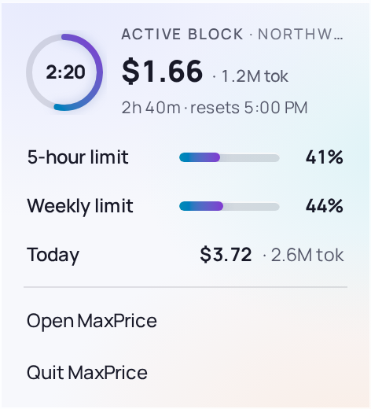

# Tray and Popout

On macOS and Windows, MaxPrice keeps an icon in the menu bar or the notification area. Clicking it opens the Popout, with your limits and today's cost. By default, MaxPrice keeps running after you close its main window, and the tray icon is your way back to it.

> [!IMPORTANT]
> On Linux the Desktop client has no tray icon and no Popout. Closing its window quits it, and it has no **Start at login**.

## The tray icon

- **macOS:** a `$` in the menu bar. Beside it, the menu bar shows how much of your [5-hour limit](../concepts/blocks.md#usage-limits) you have used while a [Block](../concepts/blocks.md#blocks) is active, or else today's cost.
- **Windows:** the MaxPrice icon in the notification area. Hover over it for the same figure, as **MaxPrice — 5-hour limit 41%** or **MaxPrice — today $3.72**. Where you track several Organizations, the limit names the [Quota organization](../concepts/organizations.md#quota-organization). Windows may hide a new icon behind the **^** arrow; drag it onto the taskbar to keep it in view.

The figure updates about once a minute. While a new version is waiting, the icon wears a dot (see [Update](update.md)).

## The Popout

Click the tray icon, with either mouse button, to open the Popout beside it. Click it again, click anywhere else or press Esc to close it.

From the top:

- **Active block:** a ring counting down to the [Active block](../concepts/blocks.md#active-block)'s reset, with its cost, its tokens and the time it resets. With no Active block it reads **No active block — start a Claude Code session to open one.**
- **5-hour limit** and **Weekly limit:** how much of each you have used. They read **—** without a [session key](../concepts/blocks.md#the-claudeai-session-key).
- A third limit row, such as **Fable limit**, when your plan limits one model for the week and you turn on **Show model limit in tray popout** in Settings › Claude account.
- **Today:** today's cost and tokens.
- **↑ Update available**, while a new version is waiting. Click it to open the update prompt (see [Update](update.md)).
- **Open MaxPrice** brings the main window back, and **Quit MaxPrice** quits.

The Popout reads its numbers again each time it opens. Where you track several [Organizations](../concepts/organizations.md), its Block and limits are the Quota organization's, named after **Active block**. Under [All organizations](../concepts/organizations.md#organization-scope), **Today · all** is the day's cost over every [Tracked organization](../concepts/organizations.md#tracked-and-excluded-organizations).

## Closing the window

With **Keep running in background** on, the default, closing the main window hides it, and MaxPrice keeps running with no window: it goes on reading Claude Code's logs, reading your limits and syncing with a [Hub](../concepts/hubs.md). Open it again from the Popout's **Open MaxPrice**, or by opening MaxPrice as you would start it.

Turn **Keep running in background** off, in Settings › **Background**, and closing the window quits MaxPrice instead.

> [!NOTE]
> On Windows, the first time closing the window leaves MaxPrice running, a notification says **MaxPrice is still running**.

> [!NOTE]
> On macOS, MaxPrice leaves the Dock and the app switcher while its window is hidden, and comes back when the window does. Clicking MaxPrice in Applications or Spotlight brings the window back too.

## Quit

- **Popout:** **Quit MaxPrice**, on macOS and Windows.
- **macOS:** **Quit MaxPrice** in the MaxPrice menu, or ⌘Q, while the window is showing.
- **Windows:** the Popout's **Quit MaxPrice**, or closing the window with **Keep running in background** off.
- **Linux:** close the window.

Quitting stops MaxPrice's data engine too.

## Start at login

Turn on **Start at login** in Settings to have MaxPrice start when you sign in to your computer. It is off until you turn it on, and it is on macOS and Windows only.

A login start opens no window: the tray icon is all you see until you open the Popout or the window. If you turn MaxPrice off in Task Manager's Startup tab on Windows, Settings says so, and turning **Start at login** on again re-enables it there.

## Opening MaxPrice when it is already running

Only one MaxPrice runs at a time. Starting it again, from the Start menu, Applications or your applications menu, brings the running one's window forward, even when it was hidden.
