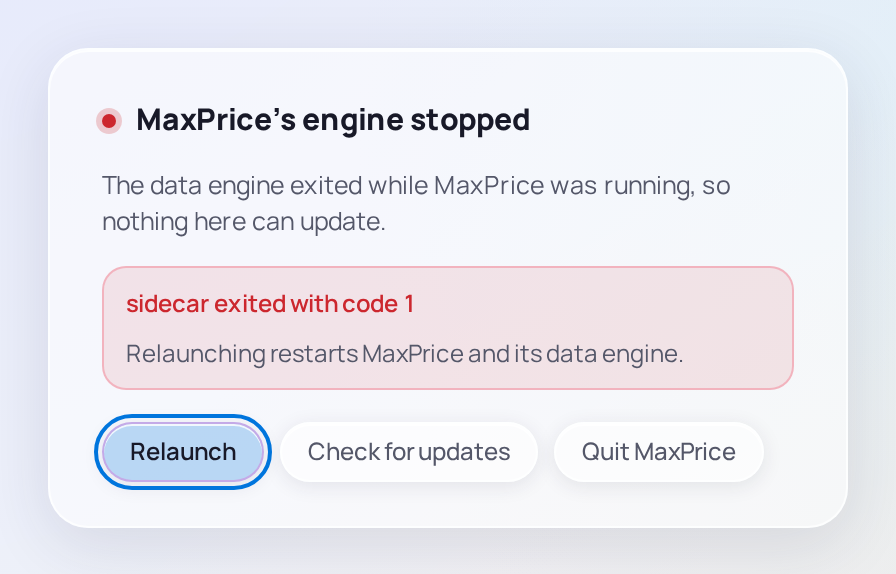

# Troubleshooting

Find what you see below. Most problems show their own message, and each has a fix here.

## The log

MaxPrice writes what happens to `logs/sidecar.log`, in its data folder ([where that is](../concepts/archive.md#desktop-client) on each system). Each start opens with a line naming the version. At 5 MB the log becomes `sidecar.log.1`, and only that one older copy is kept. When you ask for help with a problem, the log from around that time is the most useful thing to send.

## MaxPrice couldn't start

**MaxPrice couldn’t start** means its data engine didn't come up. **MaxPrice is still starting** means it is taking longer than a usual start, which can happen on a first run with many logs to read; a line under it says how far it got.

- Choose **Try again**, which restarts MaxPrice and its engine.
- Choose **Check for updates**, in case a newer version fixes it. A first click checks; if it finds one, a second click on **Update to** installs it.
- If it fails again, look at the end of the log.

## The engine stopped

**MaxPrice’s engine stopped** means the data engine quit while MaxPrice was running, so nothing in the window can update. The red line under it gives the reason the engine exited.

Choose **Relaunch**: it restarts MaxPrice and its engine, and the window opens. MaxPrice never restarts the engine by itself. On macOS and Windows the [Popout](tray.md#the-popout) says **MaxPrice’s engine stopped — relaunch to start it again.** and has a **Relaunch MaxPrice** button that does the same.

If it keeps stopping, check for updates from the same card and look at the log.

## The numbers stop changing

The chip at the top right of each page tells you whether MaxPrice is up to date:

- **live · just now** or **live · 12s ago**: new usage arrived that long ago.
- **idle**: nothing new in the last minute. That is normal while you aren't using Claude Code.
- **reconnecting…**, then **offline**: the window lost touch with the engine. It keeps retrying; if it stays offline, quit MaxPrice and start it again.

Click the chip, or press Shift+R, to refresh by hand. Two warnings may also show at the bottom of the sidebar:

- **engine catching up**: the engine is busy, so the numbers may lag for a while. It clears by itself.
- **watcher stalled**: MaxPrice isn't seeing new log lines as Claude Code writes them. Refresh by hand, or restart MaxPrice.

On macOS and Windows, **MaxPrice isn't responding — open the window to retry.** in the Popout means the engine didn't answer it. Open the window to see why.

## No usage shows

- **No Claude usage data yet** on every page: MaxPrice found no usage in the folders it reads. See [No usage yet](first-run.md#no-usage-yet).
- **A report is empty, but others aren't:** the [filters](filters.md) leave nothing. Widen the Date range, or clear the Project, Model and [Machine](../concepts/hubs.md#the-machine-filter-and-grouping-by-machine) filters.
- **Some usage is missing:** it may belong to an [Excluded organization](../concepts/organizations.md#tracked-and-excluded-organizations), whose usage MaxPrice drops on purpose. Track it in Settings › Claude account. Or Claude Code may have deleted the logs before MaxPrice first read them, and those can't be counted.
- **A Settings warning reads No Claude data paths configured:** every folder was removed from **Claude data paths**. Add one, or choose **Reset to defaults** in Settings › Reset.

## Usage limits don't show

- **⚠ Session expired — reconnect →** on Live's tiles, or **Session expired** at the bottom of the sidebar: claude.ai session keys expire every few weeks. Copy a fresh [session key](../concepts/blocks.md#the-claudeai-session-key) and connect it in Settings › Claude account.
- **That session key looks invalid or expired.** when you connect: the key was mistyped, or it is old. Copy it again, the whole `sessionKey` value.
- **Couldn't reach Anthropic — check your connection and try again.**: claude.ai couldn't be reached from this computer.
- **reports no 5-hour limit — blocks are estimated.** after an Organization's name: claude.ai reports no 5-hour limit for it, so its Blocks are [estimated](../concepts/blocks.md#exact-ended-early-and-estimated-windows).
- **Limits for … aren't readable:** claude.ai doesn't let this key read that Organization's limits, so its Blocks are estimated.
- No key at all: the limit meters don't show. See [Connect your claude.ai account](first-run.md#connect-your-claudeai-account).

## The Hub doesn't connect

Settings › Usage hub says why your [Hub](../concepts/hubs.md) doesn't connect. Each status ends **polling locally**, because MaxPrice reads your limits itself until it can use the Hub ([fallback polling](../concepts/hubs.md#fallback-polling)).

| Status                                                       | What to do                                                                                                                                     |
| ------------------------------------------------------------ | ---------------------------------------------------------------------------------------------------------------------------------------------- |
| **Hub unreachable — polling locally**                        | Check that the Hub is running, that both computers are on your [tailnet](../concepts/hubs.md#tailnet), and that the address and port are right |
| **Hub password rejected — polling locally**                  | Type the Hub's password again and choose **Save**                                                                                              |
| **Hub has no working Claude key — polling locally**          | Give the Hub a fresh session key, or leave [Auto-heal](../concepts/hubs.md#auto-heal) on so this computer sends it its own                     |
| **Hub version mismatch — update both apps; polling locally** | [Update](update.md#with-a-hub) the Hub and this computer to the same release                                                                   |

**Fleet event sync is unavailable on this hub** means the Hub reads limits but can't sync usage. Update the Hub if it is older than this computer's MaxPrice; otherwise check its console and restart it.

## A model is unpriced

An **unpriced** chip means MaxPrice has no price for one of your models, so its calculated cost is $0. Choose **Refresh prices** in Settings › Pricing. If it stays unpriced, a MaxPrice [update](update.md) is needed. See [Unpriced models](../concepts/cost-modes.md#unpriced-models).

## Windows won't run the installer

SmartScreen shows **Windows protected your PC** because the installer is not code-signed. Click **More info**, then **Run anyway** ([Install](install.md#windows)).

## Start over with the settings

**Reset to defaults**, in Settings › Reset, puts every setting back to its default and disconnects from your Hub. That includes your [Home and Tracked organizations](../concepts/organizations.md#home-organization): with more than one Organization, set them again in Settings › Claude account. To rebuild the Local archive from the logs instead, see [Starting the archive over](../concepts/archive.md#starting-the-archive-over).
