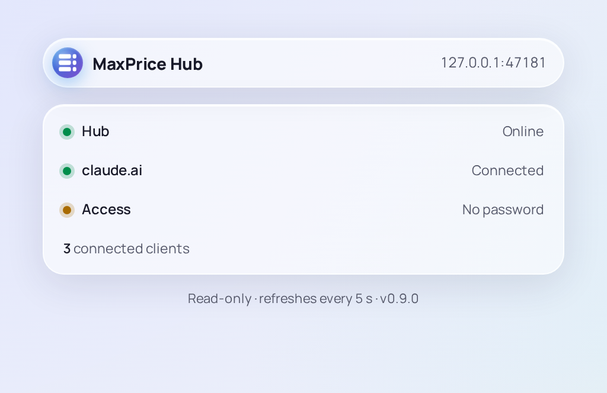

# The Hub page

The Hub page is a read-only web page that shows how a [Headless Hub](overview.md) is doing. Whoever runs the Hub publishes it through their own web server, so that you can check the Hub from a browser without signing in to its server. It shows the same rows as the Hub tray app's [Popout](../hub-tray-app/popout-and-console.md), and nothing on it changes the Hub.

## What it shows

The header reads **MaxPrice Hub**, with the address your browser reached the page at. Below it are three rows, each with a coloured dot, then the count of connected clients. The footer reads **Read-only · refreshes every 5 s**, and the Hub's version once the first reading arrives.

### Hub

Whether the Hub can do its job for the fleet.

| Reads               | What it means                                                                                                                                                                      |
| ------------------- | ---------------------------------------------------------------------------------------------------------------------------------------------------------------------------------- |
| **Online**          | The Hub is running, and listens beyond its own machine, as on your [tailnet](../concepts/hubs.md#tailnet), so clients can join it                                                  |
| **Local only**      | The Hub is running, but only its own machine can reach it, so no other machine can join. Grey when it was set up that way; amber while it waits for its network, such as Tailscale |
| **Event sync down** | Clients can reach the Hub, but its archive of the fleet's usage did not load, so they can't share their usage through it                                                           |
| **Not responding**  | The page could not get a reading: the Hub has stopped, or the web server can't reach it. The other rows go grey and read **—** until a reading comes back                          |
| **Starting…**       | The page is waiting for its first reading                                                                                                                                          |

### claude.ai

Whether the Hub can read your claude.ai [usage limits](../concepts/blocks.md#usage-limits).

| Reads            | What it means                                                                                          |
| ---------------- | ------------------------------------------------------------------------------------------------------ |
| **Connected**    | The Hub's [session key](../concepts/blocks.md#the-claudeai-session-key) works, and it reads the limits |
| **No key**       | The Hub has no session key, or has just started and is waiting for claude.ai's first answer            |
| **Key expired**  | claude.ai no longer accepts the Hub's session key                                                      |
| **Poll failing** | The Hub has a key, but it can't read the limits with it, as when it can't reach claude.ai              |

While the Hub has no working key, each client reads the limits itself, with its own key ([Fallback polling](../concepts/hubs.md#fallback-polling)).

### Access

Whether the Hub asks clients for a [Hub password](../concepts/hubs.md#hub-password): **Password set**, or **No password**, in amber, when any client that can reach the Hub may join it. The Hub password does not protect this page; who may see the page is up to the web server that publishes it.

### Connected clients

How many clients, a [Desktop client](../desktop-client/overview.md) or a [Headless client](../headless-client/overview.md) each, are connected to the Hub right now. A machine whose client is not running, or that can't reach the Hub, isn't counted.

## How it refreshes

The page reads the Hub every 5 seconds while its tab is showing. In a background tab it pauses, and it reads again as soon as you come back. A failed reading shows at once as **Not responding**, and the next reading that works brings the rows back. When the Hub is updated to a new version, the page reloads itself.

The browser tab says how the Hub is without being looked at: its title reads the Hub row, as **Online · MaxPrice Hub**, and once the first reading arrives, its icon carries the Hub row's coloured dot.

## What it doesn't show

The page shows no usage, costs or limits, no machine names, no clients' addresses, no [Organizations](../concepts/organizations.md), and nothing about the session key but whether it works. To see usage, use a client: the [Desktop client](../desktop-client/overview.md) or the [Headless client](../headless-client/overview.md).

## For the Hub's operator

The Hub serves the page only to its own machine. A web server on that machine publishes it at the Hub page URL you set, and decides who may see it. [Publish the Hub page](../../../hub/README.md#publish-the-hub-page) has the steps and the snippet, and the page's own section, [The Hub page](../../../hub/README.md#the-hub-page), says what it answers. The data behind the page also carries the addresses the Hub listens on and the counters of its fleet archive, so anyone who can see the page can read those. With no web server, an SSH tunnel to the Hub's machine opens it in your own browser.

`maxprice-hub status` prints the same rows in the Hub's terminal, with the Hub's own details beside them ([reference](../../../hub/README.md#maxprice-hub-status)).
