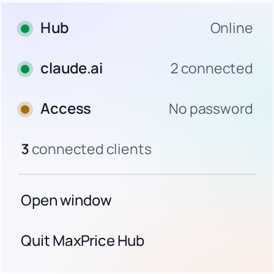
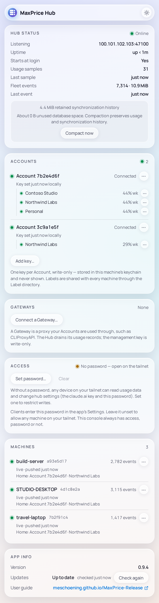
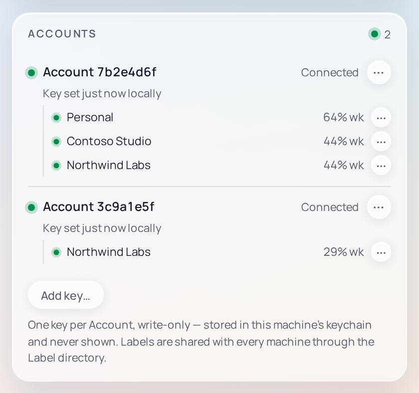

# The Popout and the console

The Hub tray app has two surfaces: the Popout, a glance at the Hub from its tray icon, and the console, the window where you run it. Closing the console only hides it; the Hub keeps running until you [quit](update-and-quit.md#quit) it.

## The Popout

Click the tray icon, with either button, to open the Popout. Click anywhere else, or press Esc, to close it.

Its three rows each answer one question:

- **Hub:** is the Hub running, and can the rest of the fleet reach it? **Online** means both.
- **claude.ai:** do the Hub's session keys read your usage limits? With one key, **Connected** means it does; **Key expired**, **Poll failing** or **No key** mean it doesn't. With keys for several claude.ai [Accounts](../concepts/organizations.md#accounts) the row counts them and never names one: **3 connected** while all of them work, **1 key expired**, **1 poll failing** or **1 needs a key** when one doesn't, **2 need a key** when more don't, and **No key works**, in red, when every key has expired or is missing. An Account the fleet's usage names but the Hub holds no key for counts as needing one.
- **Access:** does the Hub have a Hub password? **Password set** or **No password**.

Below them, **connected clients** counts the clients connected to the Hub right now. A machine that has joined but is asleep or offline isn't counted.

While the Hub is starting, or isn't answering, the claude.ai and Access rows and the count dim to a dash, since there is nothing current to show. Once the Hub has stopped, the count goes, since a stopped Hub has no clients. The [Hub page](../headless-hub/hub-page.md#what-it-shows), which the Headless Hub publishes, shows the same three rows and the same count; it explains every state each row can read. [Troubleshooting](troubleshooting.md) says what to do about the ones that need you.

Then two actions:

- **Open window** opens the console.
- **Quit MaxPrice Hub** quits the app, and the Hub with it.

When the Hub has stopped, a third action, **Restart hub**, comes first ([Troubleshooting](troubleshooting.md#the-hub-row-reads-stopped)).

Hover the tray icon for the same answer in one line, such as `MaxPrice Hub — online`, or `MaxPrice Hub — online · key expired` when the key needs you. With several keys the clause names the row, as in `MaxPrice Hub — online · claude.ai: 1 key expired`.

## The console

The console is one column of cards. The theme button at the top right switches it between the system's theme, light and dark.

### Hub status

The card's heading shows the same answer as the Popout's Hub row. Its rows:

- **Listening:** the address other machines reach the Hub at, its tailnet address and port. A client joins at `http://` and this address ([Join clients](join-clients.md)).
- **Uptime:** how long the Hub has run since it last started.
- **Starts at login:** whether the app starts when you log in to Windows ([Install](install.md#starts-at-login)).
- **Usage samples** and **Last sample:** how many usage samples the Hub has kept, and when it took or received the last one.
- **Fleet events** and **Last event:** how many [Fleet events](../concepts/hubs.md#what-a-client-sends) the Hub's archive holds and its size on disk, and when the last one arrived.

Below them, the card shows how much synchronization history the archive keeps, and how much unused space its database holds. **Compact now** gives that unused space back to the disk, and keeps all usage and synchronization history.

The card also carries any warning the Hub has, such as the Windows Firewall one ([Install](install.md#let-it-through-the-windows-firewall)), each with what to do about it.

### Claude account

A Hub that knows one claude.ai [Account](../concepts/organizations.md#accounts) in one Organization, or no Account yet, shows this card. With more, the console shows the [Accounts](#accounts) card in its place.

The card's heading shows whether the Hub's session key reads your usage limits: **Connected**, **Session expired**, **Connection error** or **Not connected**. Its rows:

- **Last sample:** when the Hub last read the limits.
- **Organization:** the [Organization](../concepts/organizations.md) the key belongs to.
- **Key:** whether a key is set, when, and by whom: `locally` when you set it in this console, or `healed by` and the id of the machine whose client sent it under [Send keys to the Hub](../concepts/hubs.md#send-keys-to-the-hub).

**Replace key…** takes a new key: paste the value of your browser's `sessionKey` cookie for claude.ai ([how to copy it](../../../hub/README.md#the-session-key)), then **Save key**. The Hub asks claude.ai which Account the key belongs to and keeps it as that Account's key, replacing the Account's earlier one; a key for another Account brings the Accounts card. Do this when the heading reads **Session expired**.

**Clear** removes the key, and the Hub stops reading the limits until a key comes back. The Hub records when you cleared it, so [Send keys to the Hub](../concepts/hubs.md#send-keys-to-the-hub) doesn't send the same key straight back; a key pasted after that, here or on any client, brings it back.

Each key is kept in the Windows Credential Manager, one entry per Account, and never shown. A key kept from before keys were per Account has no record of when or by whom it was set, so its Key row reads **Key set (time unknown)** until it moves under its Account.

### Accounts

Once the Hub knows several Accounts, whether it holds their keys or the fleet's usage names them, or one Account in several Organizations, the console shows one Accounts card. Its heading counts the Accounts the Hub knows, and how many need a key, as in **5 · 2 need a key**; its dot is the Popout's claude.ai row's.

Each row is one Account: its label, the start of its id when the label hides it, and its key's state, **Connected**, **Key expired**, **Poll failing** or **No key** (**Not read yet** for a key claude.ai hasn't answered yet). The Hub never holds an Account's email, so an Account without a label of yours reads **Account** and the first eight characters of its id. The line beneath says when and by whom its key was set, as the Claude account card's Key row does, or **No key on this Hub**. Accounts that need a key come first, then the one with the most used limit.

The Hub also lists an Account the fleet's usage names when it holds no key for it, as **No key**. Paste its key to read its limits.

Under each Account are its [Memberships](../concepts/organizations.md#accounts), one line per Organization it belongs to, most used first: the Organization's label and its most used limit, such as **91%** or **82% wk** for the weekly one, or **Idle**, **No limits**, **Can't read limits**, **Error** or **Not read yet**. While an Account's key has expired, its lines keep their last reading, greyed and marked **stale**; an Account with no key reads **Not connected**. Past three lines the rest fold into one, such as **2 more, none above 4%**, and **Show all** opens them.

An Account whose key needs you has a **Replace key…** button, or **Add key…** when there is none. Its **⋯** menu holds:

- **Replace key…** takes a new key for it, as the Claude account card does. The Hub files a key under whichever Account it belongs to, so a key for another Account goes there instead.
- **Rename…** gives the Account a label of your own, and **Use default** takes it back. The label reaches every machine, through the Hub.
- **Remove key** removes its key, and records when, so [Send keys to the Hub](../concepts/hubs.md#send-keys-to-the-hub) doesn't send the same key straight back.

Each Organization line's **⋯** menu holds **Rename organization…**. An Organization two Accounts belong to is one entry, so its new label shows under both, and on every machine.

**Add key…** at the foot of the card takes the key of an Account the Hub doesn't list yet. Once claude.ai names its Account, the console offers to label it.

### Gateways

A Gateway, such as CLIProxyAPI, serves Claude Code's requests on claude.ai Accounts it holds itself: one way to use an Account, as logging in directly is another, and neither comes first. The Hub drains its usage records, so the usage it served is counted under the right Account and Organization on every machine ([how](../concepts/organizations.md#how-maxprice-knows-the-organization)).

The card's heading counts the Gateways the Hub holds, or reads **None**. Each row is one Gateway, by its address: whether the Hub drains it (**Draining**), or why not (**Unreachable**, **Key refused**, **Statistics off** or **Error**), and when its last record arrived, as **Last record 2m ago**, or **No record yet**. **Remove** stops draining it. A Gateway a client connected and sent up shows here too, and is removed only here.

**Connect a Gateway…** takes the Gateway's URL and its management key, and checks that the Gateway answers and accepts the key. Once connected it reminds you to keep the Gateway's usage records for at least an hour, and that MaxPrice must be the only consumer of them. The key is kept in the Windows Credential Manager and never shown.

### Access

The card's heading reads **Password set**, or **No password — open on the tailnet**.

**Set password…** sets a Hub password, and **Replace password…** changes it: 1 to 128 printable ASCII characters, with no spaces. **Clear** removes it. Once a password is set, each client has to enter it to join, and after a change each client enters the new one ([Join clients](join-clients.md#with-a-hub-password)).

Without a password, any device on your tailnet can join the Hub, read the fleet's usage, and change the Hub's session key and password. The console itself always has access, password or not, so a forgotten password locks you out of nothing: replace it here.

### Machines

One row per machine in the fleet, each a client that has joined the Hub. A row shows the machine's name, the start of its machine id, and how many Fleet events it has shared. Its second line says whether it's **live**, connected now, or when it was last **seen**, and when it last **pushed** its usage. It reads **not seen since hub start** for a machine that hasn't connected since the Hub last started, **never shared** when the machine has shared no usage at all, and **not sharing** when it has pushed none since the Hub last started, as when its [Share usage events](../concepts/hubs.md#share-usage-events) is off. A machine merged into another reads **merged into** and that machine's name, as **seen 3d ago · merged into studio-mac**, in place of when it pushed. With more than one Organization or Account, a third line names the Organization of the machine's [Home membership](../concepts/organizations.md#home-membership), as in **Home: Acme Team**, and with several Accounts its Account too, as in **Home: Work · Acme Team**. A machine that hasn't said which reads **Home: not set**.

The **⋯** button on each row opens three actions:

- **Rename…** names the machine for the whole fleet, with a name no other machine has. The Hub first names a machine after its hostname.
- **Merge into…** makes this machine an alias of another, such as the old machine id a reinstall left behind: reports show its usage under the other machine's name. No usage is rewritten, and you can merge it into a different machine later.
- **Purge…** permanently deletes the machine's usage from the Hub, and the machine's row with it. Every client then reloads the fleet's usage without it. Type the machine's name to confirm. The Hub may hold the only copy of usage older than about 30 days, since Claude Code deletes its old logs, so a purge can't be undone. If the machine is still connected and sharing, its recent usage comes back unless you turn off Share usage events on it first.

### App info

- **Version:** the app's version, which is also its Hub's.
- **Updates:** whether a newer release is out, with a button to check ([Update and quit](update-and-quit.md#update)).
- **User guide:** opens this guide in your browser.
