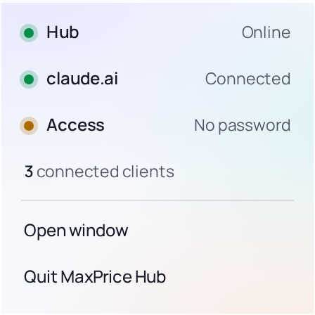
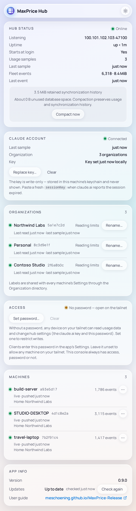

# The Popout and the console

The Hub tray app has two surfaces: the Popout, a glance at the Hub from its tray icon, and the console, the window where you run it. Closing the console only hides it; the Hub keeps running until you [quit](update-and-quit.md#quit) it.

## The Popout

Click the tray icon, with either button, to open the Popout. Click anywhere else, or press Esc, to close it.

Its three rows each answer one question:

- **Hub:** is the Hub running, and can the rest of the fleet reach it? **Online** means both.
- **claude.ai:** does the Hub's session key read your usage limits? **Connected** means it does; **Key expired**, **Poll failing** or **No key** mean it doesn't.
- **Access:** does the Hub have a Hub password? **Password set** or **No password**.

Below them, **connected clients** counts the clients connected to the Hub right now. A machine that has joined but is asleep or offline isn't counted.

While the Hub is starting, or isn't answering, the claude.ai and Access rows and the count dim to a dash, since there is nothing current to show. The [Hub page](../headless-hub/hub-page.md#what-it-shows), which the Headless Hub publishes, shows the same three rows and the same count; it explains every state each row can read. [Troubleshooting](troubleshooting.md) says what to do about the ones that need you.

Then two actions:

- **Open window** opens the console.
- **Quit MaxPrice Hub** quits the app, and the Hub with it.

When the Hub has stopped, a third action, **Restart hub**, comes first ([Troubleshooting](troubleshooting.md#the-hub-row-reads-stopped)).

Hover the tray icon for the same answer in one line, such as `MaxPrice Hub — online`, or `MaxPrice Hub — online · key expired` when the key needs you.

## The console

The console is one column of cards. The theme button at the top right switches it between the system's theme, light and dark.

### Hub status

The card's heading shows the same answer as the Popout's Hub row. Its rows:

- **Listening:** the address other machines reach the Hub at, its tailnet address and port. A client joins at `http://` and this address ([Join clients](join-clients.md)).
- **Uptime:** how long the Hub has run since it last started.
- **Starts at login:** whether the app starts when you log in to Windows ([Install](install.md#starts-at-login)).
- **Usage samples** and **Last sample:** how many usage samples the Hub has kept, and when it took or received the last one.
- **Fleet events** and **Last event:** how many [Fleet events](../concepts/hubs.md#what-a-client-sends) the Hub's archive holds and its size on disk, and when the last one arrived.

Below them, the card shows how much synchronization history the archive keeps, and how much unused space its database holds. **Compact now** gives that unused space back to the disk, and keeps all usage and synchronization history.

The card also carries any warning the Hub has, such as the Windows Firewall one ([Install](install.md#let-it-through-the-windows-firewall)), each with what to do about it.

### Claude account

The card's heading shows whether the Hub's session key reads your usage limits: **Connected**, **Session expired**, **Connection error** or **Not connected**. Its rows:

- **Last sample:** when the Hub last read your usage limits.
- **Organization:** the [Organization](../concepts/organizations.md) the key belongs to, or how many, when it lists more than one.
- **Key:** whether a key is set, when, and by whom: `locally` when you set it in this console, or `healed by` and the id of the machine whose client sent it under Auto-heal.

**Replace key…** takes a new key: paste the value of your browser's `sessionKey` cookie for claude.ai ([how to copy it](../../../hub/README.md#the-session-key)), then **Save key**. Do this when the heading reads **Session expired**. **Clear** removes the key, and the Hub stops reading your limits until a key comes back, from you or a client under [Auto-heal](../concepts/hubs.md#auto-heal).

The key is kept in the Windows Credential Manager and never shown. After the app restarts, the Key row reads **Key set (time unknown)**: the key is kept, but not when or by whom it was set.

### Organizations

This card appears when the key lists more than one Organization. Each row shows the Organization's label, whether the Hub reads its usage limits (**Reading limits**, **No limits**, **Can't read limits** or **Error**, or **Not read yet** before its first read), and when it last read them.

**Rename…** gives an Organization a label of your own, and **Use default** takes it back. A label set here reaches every machine's Settings, through the Hub.

### Access

The card's heading reads **Password set**, or **No password — open on the tailnet**.

**Set password…** sets a Hub password, and **Replace password…** changes it: 1 to 128 printable ASCII characters, with no spaces. **Clear** removes it. Once a password is set, each client has to enter it to join, and after a change each client enters the new one ([Join clients](join-clients.md#with-a-hub-password)).

Without a password, any device on your tailnet can join the Hub, read the fleet's usage, and change the Hub's session key and password. The console itself always has access, password or not, so a forgotten password locks you out of nothing: replace it here.

### Machines

One row per machine in the fleet, each a client that has joined the Hub. A row shows the machine's name, the start of its machine id, and how many Fleet events it has shared. Its second line says whether it's **live**, connected now, or when it was last **seen**, and when it last **pushed** its usage. It reads **never shared** when the machine has shared no usage at all, and **not sharing** when it has pushed none since the Hub last started, as when its [Share usage events](../concepts/hubs.md#share-usage-events) is off. With more than one Organization, a third line names the machine's [Home organization](../concepts/organizations.md#home-organization).

The **⋯** button on each row opens three actions:

- **Rename…** names the machine for the whole fleet, with a name no other machine has. The Hub first names a machine after its hostname.
- **Merge into…** makes this machine an alias of another, such as the old machine id a reinstall left behind: reports show its usage under the other machine's name. No usage is rewritten, and you can merge it into a different machine later.
- **Purge…** permanently deletes the machine's usage from the Hub, and the machine's row with it. Every client then reloads the fleet's usage without it. Type the machine's name to confirm. The Hub may hold the only copy of usage older than about 30 days, since Claude Code deletes its old logs, so a purge can't be undone. If the machine is still connected and sharing, its recent usage comes back unless you turn off Share usage events on it first.

### App info

- **Version:** the app's version, which is also its Hub's.
- **Updates:** whether a newer release is out, with a button to check ([Update and quit](update-and-quit.md#update)).
- **User guide:** opens this guide in your browser.
