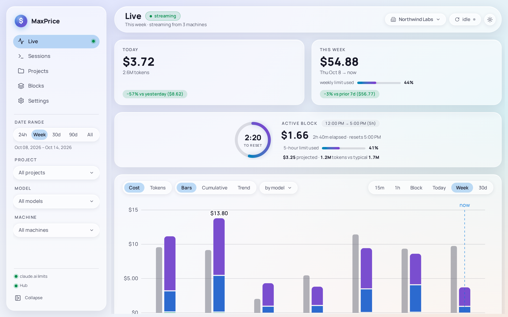

# MaxPrice User guide

MaxPrice shows what your Claude Code use would cost at API prices, and how close you are to your Claude plan's usage limits. It reads the session logs Claude Code writes on your machine, prices every request, and charts the result by day, session, project and 5-hour block.

## What MaxPrice does

- **It reads Claude Code's own logs.** Claude Code writes a log for every session under `~/.claude/projects` or `~/.config/claude/projects` (or `$CLAUDE_CONFIG_DIR/projects` when that is set). MaxPrice only reads these files and never changes them. What it keeps from them is usage alone: when each request ran, its model, its token counts and cost, and the directory it ran in. It keeps none of your prompts or Claude's replies.
- **It prices each request at Anthropic's API rates**, from LiteLLM's public model prices. On a subscription plan that is not a bill: it measures how much you use, in dollars. See [Cost modes and pricing](concepts/cost-modes.md).
- **It shows your real usage limits** once you give it your claude.ai session key: the 5-hour and weekly limits your plan sets. See [Blocks and usage limits](concepts/blocks.md).
- **It keeps your history** after Claude Code deletes its old logs. See [The archive and where data lives](concepts/archive.md).
- **It can combine several machines** through a Hub, so one view shows the usage of every machine you run Claude Code on. See [Hubs and the fleet](concepts/hubs.md).

Your usage stays on your machine unless you join it to a Hub. Apart from a Hub, MaxPrice connects to three places: claude.ai, for your usage limits, and only once you give it a session key; LiteLLM's model prices on GitHub; and MaxPrice's update channel.

## Which do I need?

| If you want to …                                                     | Use                                                                              |
| -------------------------------------------------------------------- | -------------------------------------------------------------------------------- |
| See your usage and cost on your own Mac, Windows PC or Linux desktop | The [Desktop client](desktop-client/overview.md)                                 |
| Track Claude Code on a Linux server, with no desktop                 | The [Headless client](headless-client/overview.md)                               |
| See several machines' usage in one place, from any of them           | A Hub, plus a client on each machine. See [Hubs and the fleet](concepts/hubs.md) |
| Run that Hub on an always-on Windows PC                              | The [Hub tray app](hub-tray-app/overview.md)                                     |
| Run that Hub on a Linux server, and publish its read-only Hub page   | The [Headless Hub](headless-hub/overview.md)                                     |

A Hub is optional. One machine with the Desktop client or the Headless client needs nothing else.

## The products

| Product                                        | Platforms                                                        | What it is                                                                                                      |
| ---------------------------------------------- | ---------------------------------------------------------------- | --------------------------------------------------------------------------------------------------------------- |
| [Desktop client](desktop-client/overview.md)   | macOS (Apple Silicon and Intel), Windows x64, Linux x64 (`.deb`) | The MaxPrice app: its reports, charts and Settings in a window, and on macOS and Windows a tray icon and Popout |
| [Hub tray app](hub-tray-app/overview.md)       | Windows x64                                                      | A Hub that runs in the Windows tray, with a Popout and an operator console. Its download is "MaxPrice Hub"      |
| [Headless client](headless-client/overview.md) | Linux x64, glibc 2.28 or later                                   | A client with no window: the `maxprice` terminal command, with a daemon that runs as a service                  |
| [Headless Hub](headless-hub/overview.md)       | Linux x64, glibc 2.28 or later                                   | A Hub with no window: the `maxprice-hub` terminal command, run as a service, with a read-only Hub page          |

Every product is on the [releases page](https://github.com/meschoening/MaxPrice-Release/releases). The Desktop client and the Hub tray app update themselves on macOS and Windows; on Linux, install a new `.deb` to update the Desktop client, and the two terminal binaries update only when you ask them to. This guide describes the version named at the foot of every page.

## Concepts

These pages explain the ideas every product shares. Other pages link here the first time they use one of these terms.

- [Organizations](concepts/organizations.md): which claude.ai Organization your usage belongs to, and which ones MaxPrice counts.
- [Blocks and usage limits](concepts/blocks.md): the 5-hour windows your plan limits, and the claude.ai session key that reads them.
- [Cost modes and pricing](concepts/cost-modes.md): how MaxPrice puts a dollar figure on each request.
- [Projects](concepts/projects.md): how directories, worktrees and checkouts on other machines become one project.
- [Hubs and the fleet](concepts/hubs.md): what a Hub does, what a client sends it, and what both Hubs share.
- [The archive and where data lives](concepts/archive.md): the copy of your usage MaxPrice keeps, and where each product keeps its files.
